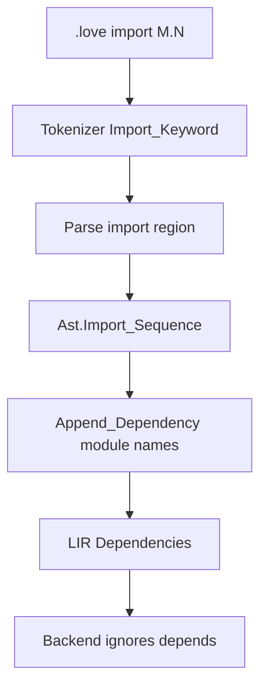

# Unit-level `import` (roadmap macro step 3)

#25 — [Compiler: unit-level import (syntax + AST; roadmap macro step 3)](https://github.com/sanelli/lovelace/issues/25)

Branch: `feature/25-unit-level-import` (linked to #25; created from `main` via `gh issue develop`).

Plan file: [`.cursor/plans/025-unit-level-import.plan.md`](025-unit-level-import.plan.md).

Roadmap: [docs/roadmap/1.001-roadmap-print-integer-wasi.md](../../docs/roadmap/1.001-roadmap-print-integer-wasi.md) § Macro step 3.

Prerequisite: macro steps 1–2 done ([#21](https://github.com/sanelli/lovelace/issues/21), [#23](https://github.com/sanelli/lovelace/issues/23)).

**How to execute:** one numbered step per invocation (or an explicit consecutive range). Do not skip the envelope (1–3) or the closing tests/PR. After each Ada edit step, run `alr exec -- gnatformat` on touched files and build/run the relevant test crate before moving on.

## Locked decisions

- **Syntax:** `import` + `qualified_identifier` + `;` (reuse existing `Parse_Qualified_Identifier`).
- **Placement:** imports are the **first** thing in the compilation unit — a file-leading `{ import_declaration }` **before** `program` / `module`:
  - `compilation_unit = { import_declaration } , ( program_unit | module_unit )`
  - Program body after header is unchanged: `begin` … `end` `.`
  - Module body after header is unchanged: `{ module_declaration }` then `end` `.`
- **Not allowed:** after `program` / `module`; inside procedure bodies; after `begin` / procedures / `#if`; inside `#if` arms (flavor still wraps procedures only).
- **Keyword:** add `Import_Keyword` / lexeme `"import"`. Do **not** add `as` (reserved form documented only).
- **AST:** named `Import_Declaration` record (`Module_Name`, `Name_Span`, `Filename`) + ordered `Import_Sequence` on `Ast.Module`. No alias field yet (add later without renaming the type).
- **Duplicates / self-import:** reject at parse with existing `Name_Clash` (`LV00011`) and a clear detail string (span on the offending import name). Exact dotted-string equality. Duplicates while parsing the leading list; self-import after the unit name is known (compare each import to `program`/`module` name).
- **LIR:** IR generator `Append_Dependency` each import name in source order. LIR codecs/Validate already support depends; backend continues to **ignore** Dependencies (no codegen change).
- **Resolution:** none — unknown modules are fine; no search path; no `MODULE.SUBROUTINE` calls.
- **Sample:** [`samples/import/ImportDecl.love`](../../samples/import/ImportDecl.love) — leading dotted import, then empty-body program (buildable; wasmtime still runs empty `run`).
- **Roadmap sync (required in this slice):** update [docs/roadmap/1.001-roadmap-print-integer-wasi.md](../../docs/roadmap/1.001-roadmap-print-integer-wasi.md) so placement/examples match file-leading imports (not after `program`/`module` headers). See step 9.
- **Out of scope:** `import … as …`; multi-unit load; call syntax; Augusta; WASI/`native(`; statements; flavor output dirs; new diagnostic codes.



## Surface grammar (this slice)

```ebnf
compilation_unit     = { import_declaration } , ( program_unit | module_unit ) ;
import_declaration   = "import" , qualified_identifier , ";" ;
program_unit         = program_header , "begin" , "end" , "." ;
program_header       = "program" , identifier , ";" ;
module_unit          = module_header , { module_declaration } , "end" , "." ;
module_header        = "module" , qualified_identifier , ";" ;
qualified_identifier = identifier , { "." , identifier } ;
```

## Current code hooks

- No `import` keyword yet: [compiler/src/lovelace-compiler-tokens.ads](../../compiler/src/lovelace-compiler-tokens.ads), keyword table in [compiler/src/lovelace-compiler-tokenizer.adb](../../compiler/src/lovelace-compiler-tokenizer.adb).
- `Ast.Module` has no imports; `Create_Module` takes only name/kind/subroutines — [compiler/src/lovelace-compiler-ast.ads](../../compiler/src/lovelace-compiler-ast.ads).
- `Parse_Compilation_Unit` today requires the first token to be `program` or `module` (~490–542). `Unit_Parse` / `To_Parse_Result` omit imports (~44–51, ~1672–1715). Programs go header → `Parse_Block` (~1514); modules go header → `Parse_Module_Declaration_List` (~1063).
- IR generator never calls `Append_Dependency` — [compiler/src/lovelace-compiler-ir_generator.adb](../../compiler/src/lovelace-compiler-ir_generator.adb); docs say “no dependencies” ([docs/ir-generator.md](../../docs/ir-generator.md)).
- LIR already has depend API + binary/text codecs + Validate (empty/dup/self) — [lir/src/lovelace-lir-modules.ads](../../lir/src/lovelace-lir-modules.ads).
- Roadmap still shows imports **after** `program` / in “unit headers” — [docs/roadmap/1.001-roadmap-print-integer-wasi.md](../../docs/roadmap/1.001-roadmap-print-integer-wasi.md) (bullet list, Import grammar example, macro step 3 wording). Must be rewritten in this slice.

## Implementation steps

### 1. GitHub issue

Create (or reuse) an issue with `gh issue create` for roadmap macro step 3. Clear proxy env before `gh`. Record `<n>`.

**Done:** [#25](https://github.com/sanelli/lovelace/issues/25).

### 2. Linked branch from `main`

```powershell
git fetch origin; git checkout main; git pull origin main
gh issue develop 25 --name feature/25-unit-level-import --checkout --base main
gh issue develop --list 25
```

**Done:** branch linked and checked out.

### 3. Save plan file

Write [`.cursor/plans/025-unit-level-import.plan.md`](025-unit-level-import.plan.md) with `#25` in the body.

**Done:** this file.

### 4. Tokenizer: `import` keyword

- Add `Import_Keyword` to `Keyword_Subtype`; register `"import"` in the keyword table.
- Update exhaustive `Describe_Token` / any keyword `case` arms that list all keywords.
- AUnit tokenizer: `import` alone and `import Foo.Bar;` tokenize as keyword + identifiers + punctuation.
- Update [docs/token-grammar.md](../../docs/token-grammar.md) and [docs/tokenizer.md](../../docs/tokenizer.md).

### 5. AST: import sequence on modules

In [compiler/src/lovelace-compiler-ast.ads](../../compiler/src/lovelace-compiler-ast.ads) / `.adb`:

- Add `Import_Declaration` + private `Import_Sequence` (vector), with `Empty_Import_Sequence`, `Append`, `Length`, `Element`.
- Extend `Create_Module` with `Imports : Import_Sequence`.
- Accessors: `Import_Count`, `Get_Import`.
- GNATdoc on every new spec entity; update all `Create_Module` call sites (parser `To_Parse_Result`, IR-generator tests that build AST by hand).

### 6. Parser: file-leading import region + clash checks

- Add `Parse_Import_Declaration` / `Parse_Import_List` (loop while peek `import`).
- In `Parse_Compilation_Unit`: parse the leading import list **first**, then dispatch on `program` / `module` as today. Attach the list to `Unit_Parse` and pass into `Create_Module`.
- Do **not** accept imports after the unit header (program/module parsers stay free of import loops).
- Duplicate import names while building the list → `Name_Clash`. After the unit name is known, self-import (`import` name = unit name) → `Name_Clash` with span on the offending import name.
- `import` after `program`/`module`, after procedures, inside `#if`, or inside `begin`…`end` → `Unexpected_Token`.
- Update [docs/compilation-unit-grammar.md](../../docs/compilation-unit-grammar.md) and [docs/parser.md](../../docs/parser.md); widen `Name_Clash` wording in [docs/diagnostics.md](../../docs/diagnostics.md) to include import module names (keep `LV00011`).

### 7. Parser AUnit

In [compiler/tests/src/lovelace-compiler-tests-parser.ads](../../compiler/tests/src/lovelace-compiler-tests-parser.ads) / `.adb` + suite registration:

- Leading imports before `program` / before `module` → AST import list order and names.
- Multiple dotted imports; units with zero imports still parse.
- Failures: `import` after `program`/`module` header; inside procedure body; after a procedure; inside `#if` arm; duplicate imports; self-import; `import` without `;` / trailing `.`; file that is only `import …;` (no unit).
- Existing empty program/module tests stay green (zero imports).

### 8. IR generator: Dependencies

- After `Create` / `Set_Origin`, loop AST imports and `Append_Dependency`.
- AUnit: program/module with imports → `Dependency_Count` / `Dependency_Name` match; empty imports still zero depends.
- Update [docs/ir-generator.md](../../docs/ir-generator.md) mapping table (imports → Dependencies). No LIR crate or backend production changes.

### 9. Sample + docs + roadmap sync

- Add [`samples/import/ImportDecl.love`](../../samples/import/ImportDecl.love):

```love
import augusta.std.io;
program ImportDecl;
begin
end.
```

- Update [docs/samples.md](../../docs/samples.md); wire into integration sample discovery/lists if they enumerate paths explicitly.
- **Change the roadmap** [docs/roadmap/1.001-roadmap-print-integer-wasi.md](../../docs/roadmap/1.001-roadmap-print-integer-wasi.md) to match file-leading imports:
  - Top bullet / macro step 3 placement: imports are first in the file, before `program` / `module` (still unit-level only; not inside subroutines).
  - Import grammar example: move `import augusta.std.io;` above `program Hello;`.
  - Any “unit headers (before procedures / before begin)” wording → “leading imports before the `program` / `module` declaration”.
  - Mark macro step 3 status (issue link), same style as steps 1–2.
- Brief docs note that `import … as …` is reserved / not parsed.

### 10. Run all tests

Run nested AUnit crates / `scripts/run-tests.ps1` (and integration tests if included). Fix regressions before PR.

### 11. Push and PR

Clear proxy env, `git push -u origin HEAD`, `gh pr create` summarizing import syntax + AST + LIR Dependencies (no resolution). PR body references `#25` and roadmap macro step 3.

## Explicit non-goals (do not pull in)

- Loading or searching imported files / Augusta tree
- Qualified calls `MODULE.SUBROUTINE` or argument literals
- External/WASI import declarations
- Emitting component imports from LIR Dependencies
- `import … as …` alias keyword or AST alias field
- Allowing imports inside `#if` arms
