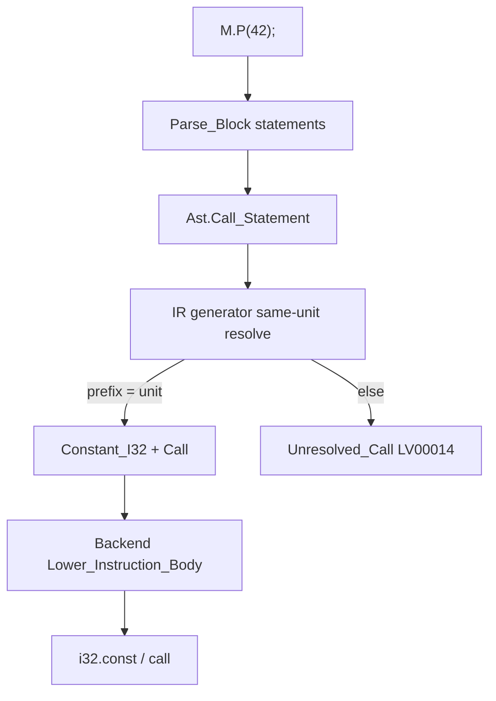

# Qualified calls + integer literals (roadmap macro step 4)

#27 — [Compiler: qualified calls + integer literal args (roadmap macro step 4)](https://github.com/sanelli/lovelace/issues/27)

Branch: `feature/27-qualified-calls-literals` (linked to #27; created from `main` via `gh issue develop`).

Plan file: [`.cursor/plans/027-qualified-calls-literals.plan.md`](027-qualified-calls-literals.plan.md).

Roadmap: [docs/roadmap/001-roadmap-print-integer-wasi.md](../../docs/roadmap/001-roadmap-print-integer-wasi.md) § Macro step 4.

Prerequisite: macro steps 1–3 done ([#21](https://github.com/sanelli/lovelace/issues/21), [#23](https://github.com/sanelli/lovelace/issues/23), [#25](https://github.com/sanelli/lovelace/issues/25)).

**How to execute:** one numbered step per invocation (or an explicit consecutive range). Do not skip the envelope (1–3) or the closing tests/PR. After each Ada edit step, run `alr exec -- gnatformat` on touched files and build/run the relevant test crate before moving on.

## Locked decisions

- **Call syntax (only):** `callee "(" [ argument_list ] ")" ";"` where `callee` is a dotted name with **at least one** `.` (last segment = procedure; prefix = module). No unqualified `Print(42);` in this slice.
- **Arguments (only):** zero or more **integer literals**, comma-separated. No expressions, floats, names, or nested calls.
- **Where:** `begin` … `end` of program units and of module procedures (same `Parse_Block`). Still no `#if` / `import` inside bodies.
- **Same-unit resolve only:** IR generator binds a call when `module_prefix = unit name` and a local procedure with that unqualified name exists. Cross-module / `import`-based resolve is **step 5** — such calls parse into the AST then fail IR with `Unresolved_Call`.
- **Export not required** for same-unit callees (export remains import-visibility for step 5).
- **LIR opcodes (format stays 1.0):**
  - `Constant_I32` (word `1`) — immediate: little-endian `i32` (4 bytes). Text: `i32.const <decimal>`.
  - `Call` (word `2`) — immediate: little-endian `u32` **1-based** subroutine index in the module. Text: `call <index>`.
  - Keep `No_Operation` = `0`.
- **Lowering shape:** for `M.P(42)` → `Constant_I32(42)` then `Call(index_of_P)`. Stack order matches WASM (`i32.const` then `call`).
- **Formal types this slice:** each formal must map to core **i32** (signed/unsigned integer size ≤ 32). Reject `integer<64>`, floats, and arity mismatches with `Invalid_Arguments`. Negative literals rejected for **unsigned** formals; range-check signed `i32`.
- **Literal evaluation:** add `To_Integer_32` on [Literals](../../compiler/src/lovelace-compiler-literals.ads) (digits → `Integer_32` + range/base handling). IR gen uses Interpret + `To_Integer_32`.
- **Diagnostics:** `Unresolved_Call` (`LV00014`), `Invalid_Arguments` (`LV00015`); extend `Ir_Generator_Error_Code` + `Error_Codes` + `Reporting.To_Error_Code`; carry `Span` on IR errors; build reports that span (not only module name span).
- **Sample:** [`samples/calls/SameModuleCall.love`](../../samples/calls/SameModuleCall.love) — module with a sink procedure and a caller that does `SameModuleCall.Sink(42);`. Buildable; WAT contains `i32.const 42` and `call $Sink`. No wasmtime console output yet (roadmap steps 6–9).
- **Out of scope:** multi-unit load; import-gated resolve; WASI/`native(`; locals/assignment; unqualified calls; float/string args; path B memory ABI; flavor output dirs.



## Surface grammar (this slice)

```ebnf
block                 = "begin" , { statement } , "end" ;
statement             = call_statement ;
call_statement        = callee_name , "(" , [ argument_list ] , ")" , ";" ;
callee_name           = identifier , "." , identifier , { "." , identifier } ;
argument_list         = integer_literal , { "," , integer_literal } ;
```

`program_unit` / `procedure_declaration` reuse `block` (bodies are no longer empty-only).

## Current code hooks

- Bodies empty-only: `Parse_Block` ([compiler/src/lovelace-compiler-parser.adb](../../compiler/src/lovelace-compiler-parser.adb) ~491–509); `Empty_Body` stub ([compiler/src/lovelace-compiler-ast.ads](../../compiler/src/lovelace-compiler-ast.ads)).
- LIR only `No_Operation` ([lir/src/lovelace-lir-opcodes.ads](../../lir/src/lovelace-lir-opcodes.ads)); IR gen never appends instructions ([compiler/src/lovelace-compiler-ir_generator.adb](../../compiler/src/lovelace-compiler-ir_generator.adb)).
- Backend model already has `Call_Function` / `I32_Constant`; emitters ready; `Lower_Instruction_Body` only strips noop ([compiler/src/lovelace-compiler-backend-lowering.adb](../../compiler/src/lovelace-compiler-backend-lowering.adb)).
- Literals interpret structure only — no numeric evaluate yet ([compiler/src/lovelace-compiler-literals.ads](../../compiler/src/lovelace-compiler-literals.ads)).
- IR errors are `Internal_Error` only; build uses module `Name_Span` ([lovelace/src/lovelace-main-build.adb](../../lovelace/src/lovelace-main-build.adb) ~410–416).

## Implementation steps

### 1. GitHub issue

Create (or reuse) an issue with `gh issue create` for roadmap macro step 4. Clear proxy env before `gh`. Record `<n>`.

**Done:** [#27](https://github.com/sanelli/lovelace/issues/27).

### 2. Linked branch from `main`

```powershell
git fetch origin; git checkout main; git pull origin main
gh issue develop 27 --name feature/27-qualified-calls-literals --checkout --base main
gh issue develop --list 27
```

**Done:** branch linked and checked out.

### 3. Save plan file

Write [`.cursor/plans/027-qualified-calls-literals.plan.md`](027-qualified-calls-literals.plan.md) with `#27` in the body.

**Done:** this file.

### 4. LIR: `Constant_I32` + `Call`

In `lovelace_lir`:

- Extend `Opcode` / `Instruction` discriminant; `Immediate_Length` 4+4; binary encode/decode; text writer (`i32.const`, `call`).
- `Modules.Validate`: `Call` target index in `1 .. Subroutine_Count`.
- AUnit: round-trip bodies with const+call; unknown opcode still fails; bad call index fails Validate.
- Update [docs/lir.md](../../docs/lir.md), [docs/lir-binary.md](../../docs/lir-binary.md), [docs/lir-text.md](../../docs/lir-text.md). Format version remains **1.0**.

### 5. Literals: `To_Integer_32`

- Add evaluate API (Result with range/`Invalid_Literal` failures) from `Integer_Literal_Value` (and/or lexeme).
- AUnit: decimal/`#16#`/negative/`42s32`; overflow and bad digits fail.
- Update [docs/literals.md](../../docs/literals.md).

### 6. AST: real statement sequence

- Replace stub `Statement_Sequence` with vector of discriminated `Statement` (`Call` only).
- `Call_Statement`: callee dotted name, span/filename, `Argument_Sequence` (lexeme + span).
- Accessors: `Append`, `Length`, `Element` / `Get_Statement`; wire `Create_Subroutine` bodies.
- Update all hand-built AST test helpers.

### 7. Parser: statements in `Parse_Block`

- `Parse_Call_Statement` / `Parse_Argument_List`; loop statements until `end`.
- Reject single-identifier callee (need a `.`); reject non-integer args with `Unexpected_Token`.
- Attach program/procedure bodies (not always `Empty_Body`).
- Update [docs/compilation-unit-grammar.md](../../docs/compilation-unit-grammar.md), [docs/parser.md](../../docs/parser.md).

### 8. Parser AUnit

- Success: nullary call; `M.P(42)`; multi-arg; multiple statements; program + module bodies.
- Failure: missing `;` / `)`; bare `P(42);`; float arg; call after `end`; empty callee segments.
- Register in suite.

### 9. IR generator: resolve + emit + diagnostics

- After creating each LIR subroutine shell (or second pass): walk AST body; resolve callee; arity/type checks; append `Constant_I32` × N then `Call`.
- Expand `Ir_Generator_Error_Code` with `Unresolved_Call` / `Invalid_Arguments` + `Span`; map via Reporting; add `LV00014`/`LV00015`; build uses error span.
- Update [docs/ir-generator.md](../../docs/ir-generator.md), [docs/diagnostics.md](../../docs/diagnostics.md).

### 10. IR generator AUnit

- Same-unit call → instruction sequence + correct index.
- Cross-module / unknown procedure → `Unresolved_Call`.
- Wrong arity / unsigned+negative / i64 formal → `Invalid_Arguments`.
- Empty body still zero instructions (no noop).

### 11. Backend: lower new opcodes

- `Lower_Instruction_Body`: `Constant_I32` → `I32_Constant`; `Call` → `Call_Function` (same 1-based index).
- AUnit: WAT/WASM contains `i32.const 42` and `call $Sink` (or index).
- Update [docs/codegen.md](../../docs/codegen.md).

### 12. Sample + docs + roadmap status

- Add [`samples/calls/SameModuleCall.love`](../../samples/calls/SameModuleCall.love); [docs/samples.md](../../docs/samples.md); integration lists if explicit.
- Mark macro step 4 status on the roadmap (issue link), same style as steps 1–3.

### 13. Run all tests

Nested AUnit crates / `scripts/run-tests.ps1` (and integration). Fix regressions before PR.

### 14. Push and PR

Clear proxy env, `git push -u origin HEAD`, `gh pr create` summarizing qualified calls + LIR const/call + same-unit lowering (no multi-unit resolve / WASI). PR body references `#27` and roadmap macro step 4.

## Explicit non-goals (do not pull in)

- Loading imported Augusta / search path / `import` gating (step 5)
- External WASI decls or component imports (steps 6–7)
- Locals, assignment, expressions beyond integer literal args (step 10)
- Unqualified same-module call sugar
- `import … as …`; flavor output directories
