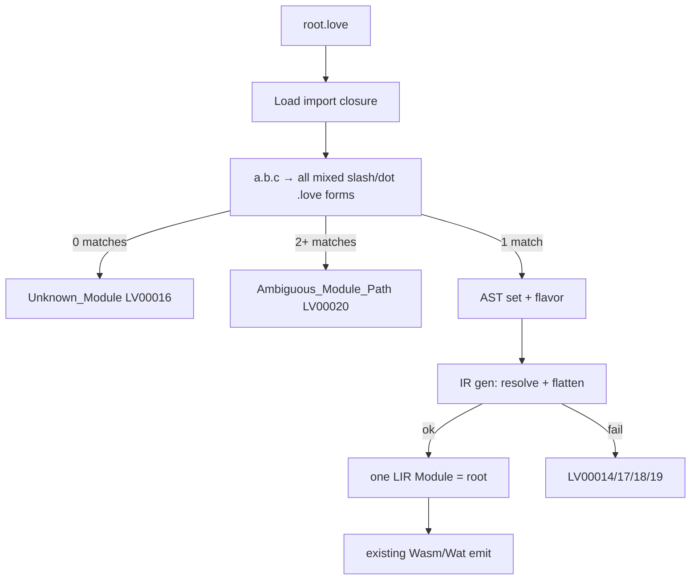

# Multi-unit build + import resolution (roadmap macro step 5)

#29 — [Compiler: multi-unit build + import resolution (roadmap macro step 5)](https://github.com/sanelli/lovelace/issues/29)

Branch: `feature/29-multi-unit-import-resolve` (linked to #29; created from `main` via `gh issue develop`).

Plan file: [`.cursor/plans/029-multi-unit-import-resolve.plan.md`](029-multi-unit-import-resolve.plan.md).

Roadmap: [docs/roadmap/001-roadmap-print-integer-wasi.md](../../docs/roadmap/001-roadmap-print-integer-wasi.md) § Macro step 5.

Prerequisite: macro steps 1–4 done ([#21](https://github.com/sanelli/lovelace/issues/21), [#23](https://github.com/sanelli/lovelace/issues/23), [#25](https://github.com/sanelli/lovelace/issues/25), [#27](https://github.com/sanelli/lovelace/issues/27)).

**How to execute:** one numbered step per invocation (or an explicit consecutive range). Do not skip the envelope (1–3) or the closing tests/PR. After each Ada edit step, run `alr exec -- gnatformat` on touched files and build/run the relevant test crate before moving on.

## Locked decisions

- **Path mapping:** module `a.b.c` (n≥1 dotted segments) maps to **every** relative path formed by placing either `/` or `.` between consecutive segments, then appending `.love`. For three segments that is:
  - `a/b/c.love`
  - `a/b.c.love`
  - `a.b/c.love`
  - `a.b.c.love`
  Single-segment modules are only `Name.love`. Mixed layouts are intentional (e.g. `augusta/std.io.love`).
- **Ambiguity:** under the full search (all roots × all candidate forms), collect **distinct existing files**. Exactly one → use it; zero → `Unknown_Module`; two or more → `Ambiguous_Module_Path` (do **not** pick a “preferred” form).
- **Search roots (ordered):**
  1. Directory of the root `.love`
  2. Current working directory
  3. Each `--include-path DIR` / `-I DIR` in CLI order (repeatable)
  4. Augusta stdlib root — **exactly one** of these, first match wins the slot (do not stack them):
     - if `AUGUSTA_HOME` is set and non-empty → use that directory only (do **not** also use `LOVELACE_HOME/lib/augusta` or the default home path)
     - else if `LOVELACE_HOME` is set and non-empty → use `LOVELACE_HOME/lib/augusta`
     - else → use `~/.lovelace/lib/augusta` (user home + `/.lovelace/lib/augusta`)
  Skip a chosen Augusta root if the directory does not exist. Ambiguity is global across this ordered scan (two different roots providing two matches still errors).
- **Unit identity for loaded deps:** `Ast.Name` must equal the imported dotted name. Root CLI file still uses existing `Unit_Name_Matches_File` / `LV00009` (basename rule). Slash/mixed-mapped deps do **not** use basename equality (`io.love` ≠ `augusta.std.io`).
- **Link model (v1):** parse the import closure → **one** combined LIR module named after the **root** unit → existing single-module backend emit. No separate LIR linker crate; no multi-component WASM.
- **Flattening / names:** root-unit subroutine names stay as today; dependency subroutines are emitted with LIR name `ModuleName.ProcedureName` (avoids `Validate` duplicate-name clashes). `Call` immediates are **global 1-based indices** in the combined module.
- **Resolve rules:**
  - Same-unit: prefix = unit name → local procedure (export **not** required) — unchanged.
  - Cross-module: prefix `M` allowed only if `import M;` is present on the **calling** unit; callee must exist on loaded module `M` and have `Export_Flag`; else distinct diagnostics below.
  - Exact module import only (no prefix import of a parent package).
- **Closure:** transitive imports; detect cycles; imported units must be `module` (reject importing a `program`); same `--flavor` on every `Parse`.
- **Artifacts:** still `obj/<Root>.lir` + `bin/<Root>.*`. Frontend rebuilds when root **or any loaded dependency** `.love` is newer than the root `.lir` (or `--force`). No per-dependency `.lir` cache in this slice.
- **LIR `Dependencies`:** root combined module still records the root’s direct import names via `Append_Dependency` (backend continues to ignore them).
- **Diagnostics (new):**
  - `Unknown_Module` → `LV00016` (no candidate file on any include/search root)
  - `Call_Without_Import` → `LV00017` (callee prefix neither self nor an import of the caller)
  - `Not_Exported` → `LV00018` (imported module has the procedure but no `Export_Flag`)
  - `Circular_Import` → `LV00019`
  - `Ambiguous_Module_Path` → `LV00020` (two or more distinct candidate files exist for one import name)
  - Keep `Unresolved_Call` (`LV00014`) for “imported/same-unit module has no such procedure”
  - Keep `Invalid_Arguments` (`LV00015`)
- **Sample:** `samples/resolve/` — small multi-file project (program + one exported module; cover at least one mixed path form). Update [`samples/import/ImportDecl.love`](../../samples/import/ImportDecl.love) so it no longer references a missing `augusta.std.io` (point at the resolve sample module or drop that import).
- **Out of scope:** WASI/`native(` (steps 6–7), real Augusta stdlib body (step 8), E2E console print (step 9), `import … as …`, unused-import warnings, per-flavor output dirs, true multi-component linking, per-unit `.lir` cache.



## Current code hooks

- Single-file build only: [`lovelace/src/lovelace-main-build.adb`](../../lovelace/src/lovelace-main-build.adb) (tokenize → parse → `Ir_Generator.Generate` → write one `.lir`).
- Imports are names only: AST `Import_Sequence`; IR `Append_Dependency`; no file load ([`compiler/src/lovelace-compiler-ir_generator.adb`](../../compiler/src/lovelace-compiler-ir_generator.adb)).
- Calls: `Find_Same_Unit_Callee` / `Lower_Call` → else `Unresolved_Call`.
- Basename rule: [`Reporting.Unit_Name_Matches_File`](../../compiler/src/lovelace-compiler-reporting.ads); docs in [`docs/cli.md`](../../docs/cli.md).
- Backend ignores LIR `Dependencies` ([`docs/codegen.md`](../../docs/codegen.md)); one `Modules.Module` in → one component out.
- Next free LV enums after `Invalid_Arguments` (`LV00015`) in [`compiler/src/lovelace-compiler-error_codes.ads`](../../compiler/src/lovelace-compiler-error_codes.ads).

## Implementation steps

### 1. GitHub issue

Create (or reuse) an issue with `gh issue create` for roadmap macro step 5. Clear proxy env before `gh`. Record `<n>`.

**Done:** [#29](https://github.com/sanelli/lovelace/issues/29).

### 2. Linked branch from `main`

```powershell
git fetch origin; git checkout main; git pull origin main
gh issue develop 29 --name feature/29-multi-unit-import-resolve --checkout --base main
gh issue develop --list 29
```

**Done:** branch linked and checked out.

### 3. Save plan file

Write [`.cursor/plans/029-multi-unit-import-resolve.plan.md`](029-multi-unit-import-resolve.plan.md) with `#29` in the body.

**Done:** this file.

### 4. Module path + include-path helpers

**Done:** `Lovelace.Compiler.Module_Path` + AUnit + cli/ir-generator docs.

New compiler package (e.g. `Lovelace.Compiler.Module_Path`):

- `Module_To_Relative_Candidates (Name) →` all `2^(n-1)` mixed slash/dot relatives + `.love` (stable enumeration order for tests/diagnostics)
- `Resolve_Module_File (Name; Roots) →` unique path | not-found | ambiguous (list the colliding paths in the detail string)
- Helper to build the default root list from: root-file dir, cwd, CLI `-I`/`--include-path`s, plus the mutually exclusive Augusta slot (`AUGUSTA_HOME` **or else** `LOVELACE_HOME/lib/augusta` **or else** `~/.lovelace/lib/augusta`)
- Pure string/path + env logic; AUnit for candidate enumeration (`a.b.c` → four forms), unique hit, zero hits, two forms present, two roots colliding, `AUGUSTA_HOME` suppressing `LOVELACE_HOME`/`~/.lovelace`, fallback to `~/.lovelace/lib/augusta` when both env vars unset
- Docs note in [`docs/cli.md`](../../docs/cli.md) / a short section in [`docs/ir-generator.md`](../../docs/ir-generator.md) (path convention + env vars)

### 5. Unit graph loader

**Done:** `Lovelace.Compiler.Unit_Graph.Load` + AUnit (dependency / unknown / ambiguous / cycle / program-as-dep).

New package (e.g. `Lovelace.Compiler.Unit_Graph`):

- Input: root `Ast.Module` + root path + search roots + flavor
- Walk imports DFS/BFS; tokenize+parse each dependency with the same flavor
- Enforce: dependency is `Module_Unit`; `Ast.Name` equals import name; cycle → `Circular_Import`
- Resolve via `Module_Path`: missing → `Unknown_Module`; ambiguous → `Ambiguous_Module_Path` (span on the import name; detail lists paths)
- Output: ordered compilation set (root first or deps-before-dependents — pick one and keep stable for flattening)

Wire stage errors through `Reporting` / new LV codes (`LV00016`, `LV00019`, `LV00020`). AUnit: diamond import, cycle, missing module, ambiguous path, program-as-dependency rejected.

### 6. Diagnostics enums

**Done:** `LV00016`–`LV00020`; IR `Call_Without_Import` / `Not_Exported`; `Unit_Graph.Surface_Error_Code`; diagnostics docs + AUnit.

Extend `Error_Codes`, `Ir_Generator_Error_Code` (and any loader-local enum), `Reporting.To_Error_Code`, [`docs/diagnostics.md`](../../docs/diagnostics.md) for `LV00016`–`LV00020`. AUnit label/mapping checks.

### 7. IR generator: multi-unit resolve + flatten

Replace single-module-only generate path with an API such as:

`Generate (Root : Ast.Module; Units : Unit_Graph.Compilation_Set) return Generate_Result`

(keep or thin-wrap `Generate (The_Module)` for single-unit tests = empty import closure).

Behavior:

1. Create LIR module named `Ast.Name (Root)`; append root direct deps.
2. Append all subroutines from every unit in the set (root names unchanged; deps mangled `Module.Proc`).
3. When lowering calls, resolve against the set:
   - same-unit → index of that unit’s procedure in the flat list
   - import-gated export → index of mangled dep procedure
   - failures → `LV00014` / `LV00017` / `LV00018` as locked
4. `Validate` the combined module

Update [`docs/ir-generator.md`](../../docs/ir-generator.md). AUnit: cross-module success; call without import; not exported; unknown subroutine; same-unit still works; name mangling uniqueness.

### 8. CLI `build` multi-unit wiring

In [`lovelace-main-build.adb`](../../lovelace/src/lovelace-main-build.adb) / help:

- Parse repeatable `--include-path DIR` and short `-I DIR` (same meaning; both append to the include-root list)
- After root parse: build search root list (file dir, cwd, `-I`s, mutually exclusive Augusta slot); `Unit_Graph.Load`; `Ir_Generator.Generate` on the set
- Stale check: root `.lir` vs mtimes of **all** files in the closure
- Info lines listing loaded dependency paths (brief)
- Update [`docs/cli.md`](../../docs/cli.md), help text (document `-I` / `--include-path`, `AUGUSTA_HOME`, `LOVELACE_HOME`, and default `~/.lovelace/lib/augusta`)

No backend changes required if flatten is correct.

### 9. Samples + ImportDecl fix

- Add `samples/resolve/` (e.g. `Caller.love` program + `Lib.love` and/or a mixed-path module such as `pkg/Util.love` ↔ `pkg.Util`).
- Fix `ImportDecl.love` so `lovelace build` still succeeds under resolution.
- Register in [`docs/samples.md`](../../docs/samples.md); ensure integration tests build the new samples (and still run entrypoint programs only).

### 10. Roadmap status

Mark macro step 5 **Done for this slice** on the roadmap (issue link + bullet summary), same style as steps 1–4. Lock the Augusta path row in the open-choices table to: all mixed slash/dot forms accepted; error if more than one file matches.

### 11. Run all tests

Nested AUnit crates / `scripts/run-tests.ps1` + integration. Fix regressions before PR.

### 12. Push and PR

Clear proxy env, `git push -u origin HEAD`, `gh pr create` summarizing multi-unit load, path mapping, import-gated resolve, single combined LIR/component (no WASI). PR body references `#29` and roadmap macro step 5.

## Explicit non-goals (do not pull in)

- Augusta stdlib / WASI external decls / console E2E (steps 6–9)
- `import … as …`, partial modules, unused-import warnings
- Per-unit `.lir` cache, flavor output directories, multi-component linking
- Unqualified call sugar; locals/expressions (step 10)
