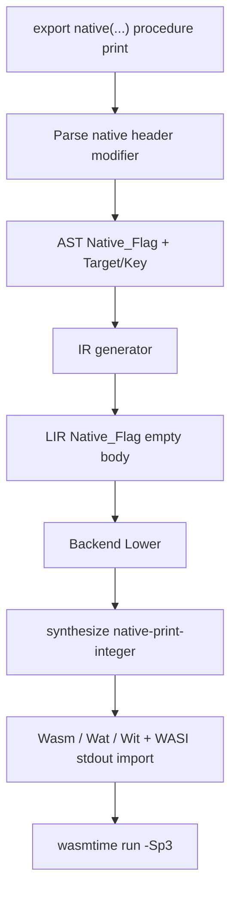

# External WASI decls, synthesized print, Augusta.io (roadmap macro-steps 6–8)

#31 — [Compiler: native WASI decls, synthesized print integer, Augusta.io (roadmap macro steps 6–8)](https://github.com/sanelli/lovelace/issues/31)

Branch: `feature/31-wasi-native-print-augusta-io` (linked to #31; created from `main` via `gh issue develop`).

Plan file: [`.cursor/plans/031-wasi-native-print-augusta-io.plan.md`](031-wasi-native-print-augusta-io.plan.md).

Roadmap: [docs/roadmap/001-roadmap-print-integer-wasi.md](../../docs/roadmap/001-roadmap-print-integer-wasi.md) § Macro steps 6, 7, and 8.

Prerequisite: macro steps 1–5 done ([#21](https://github.com/sanelli/lovelace/issues/21), [#23](https://github.com/sanelli/lovelace/issues/23), [#25](https://github.com/sanelli/lovelace/issues/25), [#27](https://github.com/sanelli/lovelace/issues/27), [#29](https://github.com/sanelli/lovelace/issues/29)).

**How to execute:** one numbered step per invocation (or an explicit consecutive range). Do not skip the envelope (1–3) or the closing tests/PR. After each Ada edit step, run `alr exec -- gnatformat` on touched files and build/run the relevant test crate before moving on.

## Locked decisions

- **External decl syntax:** `native(…)` is a **procedure-header modifier** (after optional `export`, before `procedure`). Native procedures have **no** `begin`…`end` body — the declaration ends at the header `;`.

```ebnf
procedure_declaration = ordinary_procedure | native_procedure ;
ordinary_procedure    = [ "export" ] , "procedure" , identifier ,
                        "(" , [ parameter_list ] , ")" , ";" , block , ";" ;
native_procedure      = [ "export" ] , native_clause , "procedure" , identifier ,
                        "(" , [ parameter_list ] , ")" , ";" ;
native_clause         = "native" , "(" , string_literal , "," , string_literal , ")" ;
```

Example:

```love
export native("wasi", "native-print-integer") procedure print(value : integer);
```

- **`native` keyword:** new tokenizer keyword (like `export` / `import`). First string = **target** (this milestone: only `"wasi"`). Second string = **intrinsic key** (closed set below).
- **Closed intrinsic keys (v0):** only one —

  | Key | Signature | Role |
  | --- | --- | --- |
  | `native-print-integer` | `(value : integer)` → unit | Backend synthesizes decimal formatting (optional `-`, digits) and writes those ASCII bytes to WASI 0.3 stdout |

  No `print-char` intrinsic in this slice (deferred until a later I/O milestone if still useful).
- **Unknown target/key:** diagnose at IR or backend (prefer IR when the compile flavor is known): e.g. `Unknown_Native_Binding` → next free `LV00021`.
- **Flavor gate:** `native("wasi", …)` is only valid when `--flavor wasi` (the surviving `#if` arm already implies this for Augusta). If somehow present under another flavor → same diagnostic. Do **not** implement `native("native", …)` / `native("web", …)` in this slice.
- **Formatting fork (replaces roadmap path A for this milestone):** guest-visible API stays `print(integer)`; implementation is a **compiler-synthesized** WASM body marked `native("wasi", "native-print-integer")`, not a host `s32` formatter and not yet a hand-written Lovelace loop. Roadmap locked-decision row 4 and open-choices “Formatting” cell are updated accordingly. Path B (`list<u8>` write of a whole buffer from Augusta) stays deferred.
- **Why synthesize `print`:** Lovelace still has no locals, assignment, loops, or arithmetic (roadmap step 10). Augusta `.love` therefore **cannot** format digits yet. Put an explicit comment on the `print` decl that it must become a normal Lovelace body once those features exist (and once a lower-level write primitive exists if still desired).
- **WASI I/O:** stock `wasmtime run -Sp3 -W component-model-async=y`. The intrinsic lowers to **WASI 0.3** stdout (`wasi:cli/stdout@0.3.0` / `write-via-stream` with `stream<u8>` + completion future). No `love:` namespace, no custom non-WASI host import.
- **Synthesis site:** backend (`Lower` + Wasm/Wat emitters), not the IR generator. LIR stores the binding and an **empty** instruction body; calls to a native subroutine remain ordinary LIR `Call` to its index.
- **Newline policy (this slice):** `print` writes the decimal digits only — **no** trailing newline (step 9 / sample can document or add later).
- **Integer formatting rules (synthesized):**
  - `0` → `0`
  - negative → leading `-` then decimal magnitude
  - use two’s-complement `i32` range; special-case `Integer_32'First` (`-2147483648`) so magnitude negation does not overflow
  - no `+` prefix, no leading zeros (except the single `0`)
  - write ASCII bytes for `-` / digits via the synthesized WASI stdout path (character-at-a-time or small scratch buffer — implementation detail inside the one intrinsic; no separate Lovelace `print-char`)
- **LIR representation (native is not present today — add it):**
  - Today LIR only has `Export_Flag` (`2**0`) and `Entrypoint_Flag` (`2**1`) on [`Subroutine_Flags`](../../lir/src/lovelace-lir-subroutines.ads). **Add** `Native_Flag` (`2**2`) to record that the subroutine is a `native(…)` binding (no Lovelace/LIR instruction body).
  - Optional native binding on the subroutine: `Target` + `Key` (two UTF-8 strings). Present **iff** `Native_Flag`.
  - Helpers: `Has_Native`, `Set_Native_Binding` / `Native_Binding` query; mirror `Native_Flag` on AST flags if useful for IR gen.
  - Instruction body **must be empty** when `Native_Flag`; `Validate` enforces that (and rejects `Native_Flag` without binding strings / binding without flag).
  - Entrypoint must **not** be native in this slice.
  - Binary `.lir` / text `.tlir` stay version **1.0** with an additive optional native field (same pattern as origins): after subroutine origin, `native_present` `u8` then two encoded strings when present; text form includes bare `native` flag identifier plus `(native "wasi" "native-print-integer")` (or fold key into one form — pick one and document; prefer emit flag bit in flags word **and** `(native "target" "key")` when present, with empty `(body)`).
- **Component linking model unchanged:** one combined LIR module → one component (step 5). Lovelace `export` on `print` remains visibility for importers; **no** WIT export of parameterized `print`.
- **Augusta path:** in-repo [`augusta/augusta.std.io.love`](../../augusta/augusta.std.io.love) (`module augusta.std.io;`). Tests/CLI resolve via `AUGUSTA_HOME` pointing at `{repo}/augusta/` (or `-I` that dir); nested `augusta/std/io.love` remains an equivalent candidate form.
- **Out of scope (this plan):** `print-char` / other WASI intrinsics; roadmap step 9 full E2E sample/docs polish as its own issue (a **minimal** backend/integration smoke that prints `42` is allowed to prove step 7); step 10 language features; path B bulk `list<u8>`; `import … as …`; native/web real bodies; per-flavor output dirs; multi-component linking.



## Surface shape (Augusta)

```love
module augusta.std.io;

#if flavor = "wasi"

(* TEMPORARY: print is native("wasi", "native-print-integer") so the backend can
   synthesize decimal formatting and WASI 0.3 stdout writes. Once Lovelace has
   locals, assignment, loops, and integer arithmetic (roadmap step 10), replace
   this with a normal Lovelace body — not a native. *)
export native("wasi", "native-print-integer") procedure print(value : integer);

#elsif flavor = "native"

export procedure print(value : integer);
begin
end;

#elsif flavor = "web"

export procedure print(value : integer);
begin
end;

#end
end.
```

Native/web arms stay empty stubs (no-op) until those flavor milestones.

## Current code hooks

- Procedure always requires `block`: [`Parse_Procedure_Declaration`](../../compiler/src/lovelace-compiler-parser.adb) (~1591–1774); grammar in [`docs/compilation-unit-grammar.md`](../../docs/compilation-unit-grammar.md).
- Keywords closed set without `native`: [`lovelace-compiler-tokens.ads`](../../compiler/src/lovelace-compiler-tokens.ads).
- AST subroutine = flags + body only: [`lovelace-compiler-ast.ads`](../../compiler/src/lovelace-compiler-ast.ads).
- LIR flags today: only `Export_Flag` / `Entrypoint_Flag` — **no** native bit yet ([`lovelace-lir-subroutines.ads`](../../lir/src/lovelace-lir-subroutines.ads)); opcodes still only noop / `i32.const` / `call`.
- Backend emits **export-only** `wasi:cli/run@0.3.0`; **no** component imports, memory, streams, or async: [`docs/codegen.md`](../../docs/codegen.md), [`Backend.Model`](../../compiler/src/lovelace-compiler-backend-model.ads), [`Backend.Wasm`](../../compiler/src/lovelace-compiler-backend-wasm.adb) (core instantiate with empty args).
- Multi-unit flatten + Augusta slot already work: [`Unit_Graph`](../../compiler/src/lovelace-compiler-unit_graph.ads), [`Module_Path`](../../compiler/src/lovelace-compiler-module_path.ads).
- Next free user diagnostic after `LV00020`: [`error_codes.ads`](../../compiler/src/lovelace-compiler-error_codes.ads).
- No `augusta/` tree in the repo yet (README already names the component).

## Implementation steps

### 1. GitHub issue

Create (or reuse) an issue with `gh issue create` covering roadmap macro-steps **6 + 7 + 8**. Clear proxy env before `gh`. Record `<n>`.

**Done:** [#31](https://github.com/sanelli/lovelace/issues/31).

### 2. Linked branch from `main`

```powershell
git fetch origin; git checkout main; git pull origin main
gh issue develop 31 --name feature/31-wasi-native-print-augusta-io --checkout --base main
gh issue develop --list 31
```

**Done:** branch linked and checked out.

### 3. Save plan file

Write [`.cursor/plans/031-wasi-native-print-augusta-io.plan.md`](031-wasi-native-print-augusta-io.plan.md) with `#31` in the body.

**Done:** this file (filename already matches issue 31).

### 4. Language: `native` header modifier (macro-step 6 — frontend)

- Tokenizer: keyword `native`.
- Parser: in `procedure_header`, after optional `export`, accept optional `native ( String , String )`, then `procedure` …. If `native` was present, **do not** parse a `block` (declaration ends at the header `;`). If absent, require `block` then `;` as today.
- AST: store optional native binding on `Subroutine` (target + key); set `Native_Flag`; body empty when native.
- Reject `native` … `begin`…`end` (native decls have no body).
- Docs: [`compilation-unit-grammar.md`](../../docs/compilation-unit-grammar.md), [`tokenizer.md`](../../docs/tokenizer.md) / [`token-grammar.md`](../../docs/token-grammar.md), [`parser.md`](../../docs/parser.md).
- AUnit: parse success for `export native("wasi", "native-print-integer") procedure print(…);`; reject missing comma/paren; reject native + `begin`; sample under `samples/native/` (decls only, may not fully lower until later steps).

**Done:** keyword + AST `Native_Flag` / binding; parser header form; AUnit tokenizer/parser; sample [`samples/native/NativePrint.love`](../../samples/native/NativePrint.love); docs updated. (`gnatformat` not on PATH in this environment.)

### 5. LIR: `Native_Flag` + binding metadata (macro-step 6 — IR types)

- **Add** `Native_Flag : constant Subroutine_Flags := 2**2` (not in tree today) plus `Has_Native` and binding get/set on [`Subroutines`](../../lir/src/lovelace-lir-subroutines.ads).
- `Validate`: native ⇒ empty body + both binding strings non-empty; non-native ⇒ no binding; reject native+entrypoint.
- Binary + text codecs round-trip the flag and binding; update [`lir-binary.md`](../../docs/lir-binary.md), [`lir-text.md`](../../docs/lir-text.md), [`lir.md`](../../docs/lir.md).
- AUnit encode/decode/validate cases in `lovelace_lir_tests`.

**Done:** `Native_Flag` / `Set_Native_Binding` / codecs (`native_present`); `Invalid_Native_Binding`; AUnit + lir docs.

### 6. IR generator + diagnostics (macro-step 6 — lower)

- When AST has native binding: create LIR subroutine with `Native_Flag` + binding, **no** instructions.
- Check target/key against the closed wasi set when flavor is `wasi` (only `"wasi"` + `"native-print-integer"`); emit `Unknown_Native_Binding` (`LV00021`) otherwise.
- Calls to native procedures resolve like any other procedure (step 5 rules); arguments still integer literals only at call sites.
- Wire `Reporting` / docs [`diagnostics.md`](../../docs/diagnostics.md).
- AUnit: native lowers; unknown key fails; normal bodies unchanged.

**Done:** IR lowers `Native_Flag` + binding; closed set `wasi`/`native-print-integer`; `Unknown_Native_Binding` → `LV00021`; AUnit + docs.

### 7. Backend: WASI imports + intrinsic synthesis (macro-step 7)

This is the largest slice.

**Model extensions** ([`Backend.Model`](../../compiler/src/lovelace-compiler-backend-model.ads)):

- Represent required **component imports** (at least `wasi:cli/stdout@0.3.0` with `write-via-stream`).
- Allow core functions whose bodies are not only `I32_Constant` / `Call_Function` — enough ops to implement `native-print-integer` (locals, arithmetic, stores, control flow, and whatever core ops the stream write path needs). Prefer extending `Core_Instruction` / lowering helpers rather than string-pasting WAT only in one emitter; **Wasm and Wat must stay equivalent**.

**Lowering** ([`Backend.Lowering`](../../compiler/src/lovelace-compiler-backend-lowering.adb)):

- For each LIR subroutine with `Native_Flag`, match `(Target, Key)` and **replace** the empty body with a synthesized core function (do not emit an empty `(func …)`).
- Non-native subroutines unchanged.
- When the wasi print intrinsic is present, attach the stdout import graph to the component model (core instantiate gains import args; canon lower of imported funcs as needed).

**`native-print-integer` synthesis (conceptual):**

1. Local copy of `value`.
2. Format decimal ASCII into a small scratch buffer in guest linear memory (sign + digits; `Integer_32'First` special case).
3. Produce a `stream<u8>` (or equivalent WASI 0.3 write path) for those bytes — writing one byte at a time is fine for v0 if simpler.
4. Canon-lower call `write-via-stream`; await/complete the returned future per WASI 0.3 / component-model async as required by `wasmtime -Sp3`.
5. Prefer **trap on write failure** so tests fail loudly.
6. No trailing newline.
7. Add minimal memory + any `cabi_realloc` the chosen write path needs.

**Emitters / WIT:**

- Extend Wasm + Wat to emit imports, memory, and richer core bodies.
- Companion WIT gains the corresponding `import` lines for stdout (still export `wasi:cli/run@0.3.0` when an entrypoint exists).
- Update [`docs/codegen.md`](../../docs/codegen.md): remove “no imports” for this slice; document intrinsic synthesis and run flags.

**Validation:**

- AUnit on lowered model / WAT fragments (contains import + synthesized func).
- Integration smoke (allowed here even though step 9 is separate): small program that imports `augusta.std.io` and calls `print(42)` once Augusta exists (step 8); `wasm-tools validate`; `wasmtime run …` stdout is `42`.

**Done:** Model imports + richer core ops; `Native_Print` synthesizes decimal + `write-via-stream`; Wat/Wasm/Wit emit stdout graph; AUnit `backend: native print integer`; codegen docs; smoke `print(42)` → `42` under wasmtime.

### 8. Augusta `augusta.std.io` (macro-step 8)

- Add [`augusta/std/io.love`](../../augusta/std/io.love) exactly as in **Surface shape** (including the TEMPORARY comment on `print`).
- Document module + flavor behavior under `docs/` (short `docs/augusta.md` or a section in [`docs/cli.md`](../../docs/cli.md) / samples).
- Point integration / compiler tests at repo `augusta/` via `AUGUSTA_HOME` (or `-I`); do not require users to install into `~/.lovelace` for CI.
- Native/web stub arms compile under `--flavor native|web` but need not print.

**Done:** [`augusta/augusta.std.io.love`](../../augusta/augusta.std.io.love) (TEMPORARY note in [`docs/augusta.md`](../../docs/augusta.md) — Lovelace has no source comments yet); sample [`samples/io/HelloPrint.love`](../../samples/io/HelloPrint.love); integration `-I` + `AUGUSTA_HOME=<repo>/augusta` in `scripts/run-tests.ps1`.

### 9. Roadmap status

Mark macro-steps **6, 7, and 8** Done for this slice (issue link + summary bullets). Update locked decisions / open-choices:

- External decl syntax → `native("wasi", "…")` as locked above.
- Formatting → synthesized `native-print-integer` (temporary until step 10); no `print-char` in this milestone.

**Done:** roadmap §6–8 status + locked formatting / `native(…)` open-choice rows (issue #31).

### 10. Run all tests

Nested AUnit crates / `scripts/run-tests.ps1` + integration. Fix regressions before PR.

**Done:** `pwsh scripts/run-tests.ps1` green (unit + integration, including HelloPrint).

### 11. Push and PR

Clear proxy env, `git push -u origin HEAD`, `gh pr create` summarizing steps 6–8. PR body references `#31` and the roadmap.

**Done:** branch pushed; PR opened for #31 (roadmap macro-steps 6–8).

## Explicit non-goals (do not pull in)

- `print-char` / other character-level WASI intrinsics
- Full roadmap step 9 sample/docs milestone (beyond the smoke needed to prove stdout)
- Step 10 locals / expressions / casts as general language features
- Hand-written Lovelace digit loops in Augusta (explicitly deferred; comment only)
- `native("native"/"web", …)`, `love:` imports, JIT / `libaugusta`
- Bulk string/`list<u8>` formatting API (path B)
- True multi-component linking; per-flavor output directories
- Trailing newline policy bikeshed beyond “no newline in this slice”
