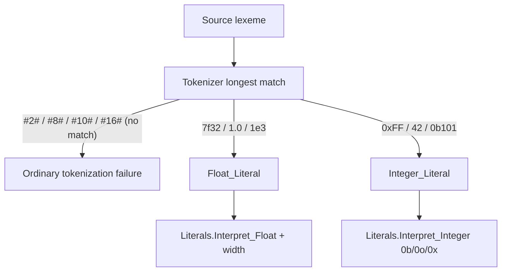

# Integer / float literal reform (roadmap 1.002 macro step 3)

#39 — https://github.com/sanelli/lovelace/issues/39

Branch: `feature/39-literal-reform` (from `main` via `gh issue develop`).

Plan file: [`.cursor/plans/039-literal-reform.plan.md`](039-literal-reform.plan.md).

Roadmap: [docs/roadmap/1.002-roadmap-replace-synthesized-print.md](../../docs/roadmap/1.002-roadmap-replace-synthesized-print.md) § Macro step 3.

**How to execute:** one numbered step per invocation (or an explicit consecutive range). Do not skip the envelope (1–3) or the closing tests/PR. After each Ada edit step, run `alr exec -- gnatformat` on touched files and build/run the relevant test crate before moving on.

## Locked decisions

### Integers (replace `#base#`)

| Form | Meaning |
| --- | --- |
| `0b` / `0B` + binary digits | Base 2 (replaces `#2#`) |
| `0o` / `0O` + octal digits | Base 8 (replaces `#8#`) |
| `0x` / `0X` + hex digits | Base 16 (replaces `#16#`) |
| plain digits | Decimal only (no `#10#`) |

- Optional leading `+` / `-` unchanged
- Optional `s` / `u` + optional `8|16|32|64` size suffixes unchanged
- **No** Ada-style `#BASE#` forms (`#2#`, `#8#`, `#10#`, `#16#`) — they are **not** in the integer pattern, so they are an ordinary **tokenization failure** (existing unexpected-character / invalid-token path). **No** dedicated `Obsolete_Based_Literal` / `LV00027` (or similar) diagnostic
- Directives (`#if` / `#elsif` / `#else` / `#end`) unchanged and still match before any literal attempt; `#16#FF` must not become a successful integer token

Examples: `42`, `-3u16`, `0xFFs32`, `0b1010`, `0o755`, `+0Xdead`

### Floats (revised vs earlier roadmap draft)

**Overrides** the roadmap’s earlier “trailing `f` → float&lt;32&gt; / bare → float&lt;64&gt;” note:

| Lexeme shape | Width |
| --- | --- |
| Has `.` and/or exponent, **no** width suffix | **`float<32>`** |
| Trailing `f32` / `F32` | **`float<32>`** |
| Trailing `f64` / `F64` | **`float<64>`** |

Allowed mantissa forms (optional leading `+` / `-`):

1. `digits . [digits] [exponent] [width]` — e.g. `3.14`, `7.`, `1.0e-3`, `2.3f64`
2. `digits exponent [width]` — e.g. `1e3`, `-2.5E3` is form 1; `1E3f32`
3. `digits width` — e.g. `7f32`, `0F64` (no `.` / exp required when width is present)

Where `exponent = (e|E) [+|-] digits` and `width = f32|F32|f64|F64`.

- **No** lone `f` / `F` suffix (that spelling is retired before it lands)
- Type-position bare `float` stays an alias of **`float<32>`** (do **not** change `Parse_Float_Type` default in this PR)
- `0xf` / `0xF32` remain **hex integers** (based prefix wins); float width suffixes apply only to **decimal** float forms above
- Scan order stays **float before integer** so `7f32` is one `Float_Literal`, not `7` + junk
- Underscores in digit groups still out of scope
- Still no `To_Float_*` evaluation / float call-args in this step (parser call args remain integer-only) — but `Interpret_Float` must record resolved width

### Out of scope

- Boolean / `true` / `false` (step 4)
- Changing bare type `float` → 64
- Float expression typing in the parser/IR beyond storing width on `Float_Literal_Value`
- Underscore digit separators
- A dedicated diagnostic for old `#base#` spellings

## Architecture



## Steps

### 1–3. Envelope

Create issue, branch from latest `main`, rename/save this plan with `#39` in the body.

### 4. Tokenizer

Files: [`lovelace-compiler-tokenizer.adb`](../../compiler/src/lovelace-compiler-tokenizer.adb)

- Replace `Integer_Literal_Pattern` with `0b`/`0o`/`0x`/decimal + existing `s`/`u` suffixes
- Replace `Float_Literal_Pattern` with the three forms above (including `f32`/`f64` / `F32`/`F64`)
- Keep float-before-integer registration order
- Do **not** add a special obsolete-based scanner or `LV…` code — dropping `#base#` from the integer pattern is enough; leftover `#…` fails like any other unrecognized input (directives still match)
- AUnit: update [`Test_Numeric_Literals`](../../compiler/tests/src/lovelace-compiler-tests-tokenizer.adb); `#16#FF` is a tokenization failure; ensure `#if` still works; `0xf` is integer; `7f32` is float

### 5. Literals interpreter

Files: [`lovelace-compiler-literals.ads`](../../compiler/src/lovelace-compiler-literals.ads) / `.adb`

- `Interpret_Integer`: parse new prefixes only (no `#base#` path)
- `Float_Literal_Value`: add width field (`Types.Float_Size`, default **Bits_32** when suffix absent on `.`/exp forms; from suffix when present)
- AUnit: rewrite [`Test_Integer_Forms`](../../compiler/tests/src/lovelace-compiler-tests-literals.adb) / float tests / invalid cases; keep `To_Integer_32` coverage on new spellings

### 6. Docs + roadmap lock

- Rewrite [`docs/literals.md`](../../docs/literals.md) (fix the wrong `16#FF#` examples)
- Update [`docs/token-grammar.md`](../../docs/token-grammar.md), [`docs/tokenizer.md`](../../docs/tokenizer.md)
- Update roadmap 1.002 § locked float decisions + macro step 3 status with `#39`: document **`f32`/`f64` suffixes** and **bare `.`/exp → float&lt;32&gt;** (explicitly supersede earlier `f` / float64-default draft)

### 7. Sample + stray `#base#` cleanup

- Add [`samples/literals/`](../../samples/literals/) focused unit (e.g. module or comments-only program is fine if calls still integer-only — prefer a tiny module that tokenizes/parses with new literals in a procedure signature comment… better: a program/module that uses new integer literals in existing call-arg positions like `Sink(0x2A);` if a local sample module is added)
- Update [`docs/samples.md`](../../docs/samples.md)
- Grep tests/docs for `#2#` / `#16#` Lovelace spellings and migrate

### 8. Full tests

```bash
pwsh scripts/run-tests.ps1
```

### 9. Push / PR

Clear proxy env, push, `gh pr create` closing `#39`, referencing roadmap 1.002 step 3.

## Non-goals (reminders)

- Do not implement boolean, `:=`, operators, or float call arguments
- Do not change type-position bare `float` away from `float<32>`
- Do not add digit underscores
- Do not add `Obsolete_Based_Literal` / `LV00027` (or any dedicated obsolete-literal diagnostic)
