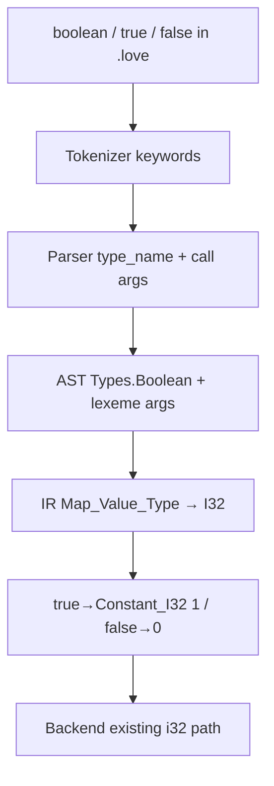

# Boolean type + `true` / `false` (roadmap 1.002 macro step 4)

#41 — https://github.com/sanelli/lovelace/issues/41

Branch: `feature/41-boolean-type` (from `main` via `gh issue develop`).

Plan file: [`.cursor/plans/041-boolean-type.plan.md`](041-boolean-type.plan.md).

Roadmap: [docs/roadmap/1.002-roadmap-replace-synthesized-print.md](../../docs/roadmap/1.002-roadmap-replace-synthesized-print.md) § Macro step 4.

**How to execute:** one numbered step per invocation (or an explicit consecutive range). Do not skip the envelope (1–3) or the closing tests/PR. After each Ada edit step, run `alr exec -- gnatformat` on touched files and build/run the relevant test crate before moving on.

## Locked decisions

### Surface language

| Topic | Decision |
| --- | --- |
| Type keyword | **`boolean`** (case-sensitive keyword, like `integer` / `float`) |
| Literals | **`true`** / **`false`** — **keywords**, not identifiers |
| Type position | `boolean` allowed wherever `type_name` is today (procedure parameters in this slice) |
| No size param | There is **no** `boolean<…>` form |
| Logical / comparison ops | **Out of scope** for this PR — roadmap steps 8–9 (`and` / `or` / `not` / `and then` / `or else`, and `>` / `<` / …) |

### Frontend vs LIR representation

| Layer | Representation |
| --- | --- |
| Frontend `Types.Type_Expression` | New **`Type_Kind.Boolean`** — **distinct** from `Integer` / `Float` / `Unit` |
| LIR `Value_Type` | **No new LIR type** — `boolean` maps to **`I32`** |
| Wasm / backend | Existing i32 path (same as signed `integer` / `integer<32>`) |

**Canonical bit pattern (locked):**

| Lovelace value | LIR / i32 |
| --- | --- |
| `false` | **exactly `0`** |
| `true` | **any non-zero**; when **emitting** a `true` literal, use **`1`** |

When **reading** / branching on a boolean later (`if`, loops, …), treat **`0` → false** and **anything other than `0` → true**. Do not require callers to normalize to 0/1 before a condition (normalization may still emit 0/1 for literals).

### Type safety (no silent integral ↔ boolean)

Even though LIR uses `I32`, the **language** treats `boolean` as incompatible with integer types:

- Passing an **integer literal** to a **`boolean`** formal → `Invalid_Arguments` (or a clear type mismatch diagnostic)
- Passing **`true` / `false`** to an **integer** formal → same
- Do **not** add boolean ↔ integral casts in this PR (forbidden policy already recorded under [2.001](../../docs/roadmap/2.001-roadmap-more-language-features.md))

Implication for IR call lowering: stop relying solely on “formal LIR type accepts i32 constant.” Match on the **frontend** formal `Type_Expression.Kind` (and literal kind) before emitting `Constant_I32`.

### Call arguments in this slice

Extend today’s integer-literal-only call args:

| Actual | Allowed formal |
| --- | --- |
| Integer literal (`42`, `0x2A`, …) | Integer formals that already accept i32 constants (unchanged rules) |
| `true` / `false` | **`boolean`** formals only → `Constant_I32` with `1` / `0` |

AST can keep storing the argument as a lexeme string (`"true"` / `"false"` / `"42"`) if that stays simplest; IR gen interprets accordingly. No expression AST yet (still roadmap steps 5+).

### Tokenizer / parser shape

- Add `Boolean_Keyword`, `True_Keyword`, `False_Keyword` to `Tokens.Keyword_Subtype` and the keyword table in [`lovelace-compiler-tokenizer.adb`](../../compiler/src/lovelace-compiler-tokenizer.adb)
- Parser `type_name`: `boolean_type = "boolean"` alongside integer/float forms
- Parser `argument_list`: allow `integer_literal | true | false` (update [compilation-unit-grammar.md](../../docs/compilation-unit-grammar.md))
- Grammar docs / [token-grammar.md](../../docs/token-grammar.md) / [tokenizer.md](../../docs/tokenizer.md) list the three new keywords

### Out of scope

- Locals / `:=` (step 5–6)
- Comparison and boolean operators (steps 8–9)
- `if` / loop conditions (steps 11–14) — they will consume the 0 / nonzero rule later
- New LIR opcode or `Value_Type` for bool
- Boolean return types beyond what the existing procedure shape already allows (procedures remain Unit-returning in practice)
- Boolean ↔ integer casts
- Changing Augusta `print` or HelloPrint

## Architecture



## Steps

### 1–3. Envelope

Create issue, branch from latest `main`, rename/save this plan with `#41` in the body.

### 4. Frontend `Types.Boolean`

Files: [`lovelace-compiler-types.ads`](../../compiler/src/lovelace-compiler-types.ads) / `.adb`

- Add `Boolean` to `Type_Kind`
- Add `function Boolean_Type return Type_Expression`
- Keep Integer/Float fields unused for Boolean (same pattern as Unit)
- AUnit if there is a types test surface; otherwise cover via parser/IR tests
- Touch docs that list type kinds if present

### 5. Tokenizer keywords

- Register `boolean`, `true`, `false` as keywords (case-sensitive)
- AUnit: they tokenize as keywords; `True` / `Boolean` remain identifiers; keyword reservation does not steal prefixes like `truehood` (identifier) — follow existing keyword-vs-identifier rules (`true` alone is keyword; longer names are identifiers)

### 6. Parser

Files: [`lovelace-compiler-parser.adb`](../../compiler/src/lovelace-compiler-parser.adb)

- `Parse_Type` / `type_name`: accept `boolean` → `Types.Boolean_Type`
- Reject `signed boolean`, `boolean<32>`, etc. as ordinary parse errors (unexpected token)
- `Parse_Argument_List`: accept `Integer_Literal` **or** keyword `true` / `false`; store lexeme as today
- AUnit: module procedure with `boolean` param; call with `true`/`false`; reject bad type spellings as useful

### 7. IR generator

Files: [`lovelace-compiler-ir_generator.adb`](../../compiler/src/lovelace-compiler-ir_generator.adb)

- `Map_Value_Type`: `Boolean` → `Lir.Types.I32`
- Call lowering:
  - If formal is frontend **Boolean**: require actual lexeme `true` or `false`; emit `Constant_I32` **1** or **0**; reject integer literals
  - If formal is frontend **Integer** (existing path): require integer literal via `To_Integer_32`; reject `true`/`false`
  - Do not use “LIR is I32 ⇒ any i32 constant OK” for booleans
- AUnit: boolean param lowers to I32; `Sink(true)` / `Sink(false)` emit 1/0; cross-kind args fail with `Invalid_Arguments`
- Update [`docs/ir-generator.md`](../../docs/ir-generator.md) type map + call-arg rules

### 8. Docs + roadmap lock

- [token-grammar.md](../../docs/token-grammar.md), [tokenizer.md](../../docs/tokenizer.md), [compilation-unit-grammar.md](../../docs/compilation-unit-grammar.md), [parser.md](../../docs/parser.md) as needed
- Roadmap 1.002 § Boolean + macro step 4: lock **LIR = i32**, **0 → false**, **nonzero → true**, emit **0/1** for literals; status `#41`
- Fix any leftover “TBC: dedicated bool vs i32” wording

### 9. Sample

- Add [`samples/boolean/`](../../samples/boolean/) e.g. module with `procedure Sink(Flag : boolean);` and `Sink(true);` / `Sink(false);`
- Update [`docs/samples.md`](../../docs/samples.md)

### 10. Full tests

```bash
pwsh scripts/run-tests.ps1
```

### 11. Push / PR

Clear proxy env, push, `gh pr create` closing `#41`, referencing roadmap 1.002 step 4.

## Non-goals (reminders)

- Do not implement `and` / `or` / `not` / comparisons / `if` / loops / locals in this PR
- Do not add a LIR `Bool` / `I1` value type
- Do not allow integer literals as booleans (or the reverse) even though both lower to i32
- Do not change float/integer literal rules from step 3
