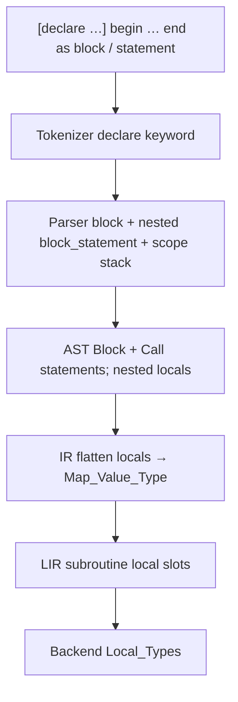

# Variable declarations via `declare` / nestable blocks (roadmap 1.002 macro step 5)

#43 — https://github.com/sanelli/lovelace/issues/43

Branch: `feature/43-variable-declarations` (from `main` via `gh issue develop`).

Plan file: [`.cursor/plans/043-variable-declarations.plan.md`](043-variable-declarations.plan.md)

Roadmap: [docs/roadmap/1.002-roadmap-replace-synthesized-print.md](../../docs/roadmap/1.002-roadmap-replace-synthesized-print.md) § Macro step 5.

**How to execute:** one numbered step per invocation (or an explicit consecutive range). Do not skip the envelope (1–3) or the closing tests/PR. After each Ada edit step, run `alr exec -- gnatformat` on touched files and build/run the relevant test crate before moving on.

## Locked decisions

### Block as statement

A **`begin` … `end` block is a statement** (a distinct statement kind). Program and ordinary-procedure bodies are that same block form (unit/procedure terminator stays `.` / `;` after the outer `end`). Nested blocks appear **inside** a statement list and, as statements, end with **`;`** after `end`.

Optional **`declare` part** may appear **immediately before** `begin` on any such block. When `declare` is present, **at least one** variable declaration is required (empty `declare` then `begin` is illegal).

Not on `@intrinsic` / `@native` headers (no body). Modules have no unit-level block; module-level variables are **not** in this step.

### Syntax (Ada-style)

```love
program Demo;
declare
   Var1, Var2 : integer;
   Flag : boolean;
   Byte : unsigned integer<8>;
begin
   declare
      Inner : float<32>;
   begin
      { statements — still call-only in this slice }
   end;
end.
```

```love
procedure Run();
begin
   declare
      A, B : integer;
   begin
   end;
end;
```

EBNF (locked):

```ebnf
block                 = [ declare_part ] , "begin" , { statement } , "end" ;
declare_part          = "declare" , variable_declaration , { variable_declaration } ;
variable_declaration  = identifier , { "," , identifier } , ":" , type_name , ";" ;

statement             = call_statement
                      | block_statement ;
block_statement       = block , ";" ;

(* unchanged unit shapes; block replaces bare begin…end *)
program_unit          = program_header , block , "." ;
ordinary_procedure    = … , block , ";" ;
```

| Rule | Decision |
| --- | --- |
| Keyword | **`declare`** (case-sensitive), new tokenizer keyword |
| Name list | One or more identifiers separated by `,` (same spirit as `parameter_group`) |
| Colon | **Required** `:` before the type |
| Semicolon | **Required** `;` after each declaration group |
| Non-empty declare | If `declare` is present → **≥1** `variable_declaration` (reject `declare begin`) |
| Optional declare | Omitting `declare` keeps today’s `begin` … `end` shape |
| Nested blocks | `block_statement` may appear anywhere a `statement` is allowed (including inside nested blocks) |
| Nested terminator | Nested `block_statement` ends with `end;` (semicolon required) |
| Outer terminators | Program: `end.` — Procedure: `end;` after the body block (unchanged) |
| Types | **`type_name`** as today — any supported frontend type |
| Initializers | **None** in this step — no `:=` in declarations (assignment → step 6) |
| Bare nested `begin`…`end;` | Allowed (declare optional on every block) |

Illustrative nesting / visibility:

```love
program P;
declare
   Outer : integer;
begin
   declare
      Inner : boolean;
   begin
      { Outer visible here; Inner visible here }
   end;
   { Outer visible here; Inner NOT visible here }
end.
```

```love
module M;
procedure Sink(Value : integer);
declare
   Tmp : integer;
begin
   begin
      { Value and Tmp visible; no new names }
   end;
end;
end.
```

### Scoping and names

Lexical scopes form a **chain**: unit entities → parameters (procedure) → outer block declare → nested block declare → …

**Unit entity namespace** (same compilation unit; same spirit as today’s procedure-vs-module / duplicate-procedure checks):

| Current entities a local must not reuse | Notes |
| --- | --- |
| Program or module name | Unqualified unit name (e.g. local `Demo` in `program Demo` / `module Demo`) |
| Subroutine names | Any procedure declared in that module (or the synthetic entry name rules for programs, if any apply) |

**Forward-compatible rule:** a local name must not clash with **any named entity declared in the same module/program unit** — today that is the unit name and subroutines; when user-defined types / records / constants / etc. land, they join the same unit-level reserved set and locals keep the same `Name_Clash` policy. Implementation should check against a single “unit entity names” set (or equivalent helpers) rather than hard-coding only “module name + procedure list,” so later entity kinds plug in without rewriting declare logic.

| Rule | Decision |
| --- | --- |
| Visibility inward | Names from an enclosing scope are **visible** inside nested blocks |
| Visibility outward | Names declared in a nested block are **not** visible outside that block |
| No shadowing (blocks) | A nested `declare` **must not** reuse a name already bound in any **enclosing** scope (parameters or ancestor declares). **`Name_Clash` (`LV00011`)** |
| No clash with unit entities | A local **must not** reuse the program/module name, any subroutine name in the unit, or (later) other unit-level declared entities. **`Name_Clash` (`LV00011`)** |
| Same declare part | Duplicate names in one `declare_part` → **`Name_Clash`** |
| Same block vs sibling blocks | Two sibling nested blocks may each declare `X` (neither encloses the other) — **allowed**; each `X` is only visible in its own block |
| Reading / writing | Still **out of scope** for statements in this step (step 6); locals may be unused |
| Identifier form | Same as today — including **emoji** and other allowed Unicode identifiers ([tokenizer.md](../../docs/tokenizer.md)) |

### Emoji / Unicode identifier coverage (required)

Emoji (and other non-ASCII identifiers already allowed by the tokenizer) must be exercised end-to-end for **all** of these roles — not only documented as “identifiers work”:

| Role | Required coverage |
| --- | --- |
| Variable (local) | `declare` with an emoji name |
| Subroutine | `procedure` with an emoji name |
| Program name | `program` with an emoji name |
| Module name | `module` with an emoji name |

**Tests:**

- **AUnit (parser / IR as needed):** at least one fixture each for emoji local, emoji procedure, emoji program unit name, emoji module unit name (use `Utf_8.Encode` in Ada string literals where required)
- **Samples:** committed `.love` sources under `samples/` (UTF-8) that use emoji in those roles; list them in [`docs/samples.md`](../../docs/samples.md)
- **Integration tests:** register those samples in `lovelace/integration_tests` (program path → build + validate + **run**; module path → build + validate). `scripts/run-tests.ps1` must pass with these fixtures included — samples alone are not enough

Prefer a small dedicated folder (e.g. `samples/emoji/` or fold into `samples/variables/` plus a module sample) so paths stay ASCII-friendly if desired; **source lexemes** must still be real emoji identifiers.

### AST

- Promote the body from a flat statement list to an explicit **block** node: optional local-declaration sequence + ordered statements
- Statement kinds: existing **call** + new **block** (nested)
- Locals: name + `Types.Type_Expression` + source span (shared shape with parameters if clean)
- Program body and ordinary subroutine body are block nodes; `@intrinsic` / `@native` keep empty / absent bodies

### LIR / IR / backend

LIR today has **no** local slots (backend `Local_Types` exists for wasm but is unused for Lovelace locals). Nested scopes are an AST/parser concern; the function still gets a **flat** local list.

| Layer | Work |
| --- | --- |
| LIR | Add **locals** on subroutines: ordered typed locals (names for text/debug). Codecs + `Validate` (duplicate names at LIR level invalid for the flat list) |
| IR gen | Walk the block tree; allocate a LIR local for every declared name (DFS / preorder); map types with `Map_Value_Type`. Nested structure does not appear in LIR beyond the flattened slots |
| Backend | Populate `Core_Function.Local_Types` from LIR locals (after params). **No** `local.get` / `local.set` until step 6 |

### Out of scope

- `:=` / typechecker / `Lovelace_Type` hierarchy (step 6)
- Using variables in call arguments or other expressions
- Module-level variables
- `const` / immutable ([2.014](../../docs/roadmap/2.014-roadmap-const-immutable.md))
- Default / initializer expressions
- Named block labels (`end Block_Name`)
- Multiple `declare` sections on one block or `declare` after `begin`

## Architecture



## Steps

### 1–3. Envelope

Create issue (#43), branch from latest `main`, save this plan with `#43` in the body.

### 4. Tokenizer

- Add `Declare_Keyword` / lexeme `declare`
- AUnit: keyword vs `Declare` / `declared` identifiers

### 5. AST

- Block node: locals + statements; statement variant for nested block
- Program / ordinary procedure bodies use Block; intrinsic/native unchanged

### 6. Parser

- `Parse_Block`: optional `declare_part` (≥1 declaration when present) then `begin` … `end`
- `statement` = call **or** `block` + `;`
- Maintain a **scope stack** while parsing: push declare names; reject clashes with any enclosing binding (parameters pushed for procedure bodies); pop on block exit
- Also reject locals that collide with the **unit entity namespace** (program/module name, existing subroutine names; structure the check so future unit-level entity kinds reuse it)
- AUnit: outer declare; nested declare; bare nested `begin`…`end;`; sibling same-name OK; shadowing outer/param rejected; clash with unit/procedure name rejected; empty `declare` rejected; omitted declare still works
- AUnit: emoji identifier as local name; emoji as procedure name; emoji as program name; emoji as module name (`Utf_8.Encode` in fixtures)

### 7. LIR locals

- Subroutine local list (type + name); codecs; validate
- AUnit round-trip

### 8. IR generator

- Flatten all nested block locals into the entrypoint / procedure local list
- AUnit: nested + mixed frontend types (boolean→I32, integer sizes, float, …)

### 9. Backend

- Wire LIR locals into wasm/wat local sections (types only)
- Keep existing tests green; focused check if useful

### 10. Docs + roadmap

- Update grammar / tokenizer / parser / lir / ir-generator / codegen docs (block as statement, nesting, no-shadow rules)
- Lock roadmap 1.002 step 5 syntax + status `#43`

### 11. Samples + integration wiring

- [`samples/variables/`](../../samples/variables/) with an outer declare and at least one nested `declare`…`begin`…`end;` (calls may remain literal-only)
- Emoji identifier samples covering **variable**, **subroutine**, **program**, and **module** names (one or more `.love` files under e.g. `samples/emoji/` and/or combined with `variables/`)
- Update [`docs/samples.md`](../../docs/samples.md)
- Wire every new sample into [`lovelace/integration_tests`](../../lovelace/integration_tests): programs via the hello/entrypoint build fixture (build + validate + run); modules via the module build fixture (build + validate)

### 12. Full tests

```bash
pwsh scripts/run-tests.ps1
```

Must include the integration suite exercising the emoji and variables samples above.

### 13. Push / PR

Clear proxy env, push, `gh pr create` closing `#43`, referencing roadmap 1.002 step 5.

## Non-goals (reminders)

- Do not implement `:=`, operators, or the step 6 typechecker in this PR
- Do not allow variable references in call args yet
- Do not add module-level variables or declaration initializers
- Do not allow shadowing (nested or same-part duplicates)
- Do not allow locals to reuse unit-level entity names (module/program, subroutines; same policy for future entity kinds)
- Do not allow empty `declare` parts
