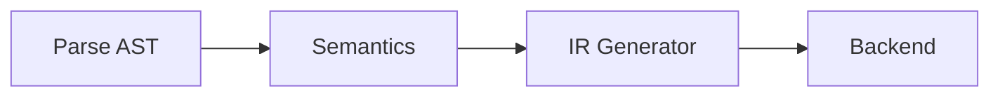

# Assignment, expressions, using scopes, and warnings (roadmap 1.002 step 6)

#45 — https://github.com/sanelli/lovelace/issues/45

Branch: `feature/45-assignment-using-semantics` (from `main` via `gh issue develop`).

Plan file: [`.cursor/plans/045-assignment-using-semantics.plan.md`](045-assignment-using-semantics.plan.md)

Roadmap: [docs/roadmap/1.002-roadmap-replace-synthesized-print.md](../../docs/roadmap/1.002-roadmap-replace-synthesized-print.md) § Macro step 6 — extend locked decisions for `using`, expressions, warnings, and CLI.

**How to execute:** one numbered step per invocation (or an explicit consecutive range). Do not skip the envelope (1–3) or the closing tests/PR. After each Ada edit step, run `alr exec -- gnatformat` on touched files and build/run the relevant test crate before moving on.

## Locked decisions

### Rename `import` → `using`

- Keyword **`using`** replaces **`import`** everywhere (tokenizer, grammar, AST naming, diagnostics text, samples, Augusta docs, rules).
- Lexeme **`import`** is an **ordinary identifier** (not a keyword). Parser step 6 hard-rejects it with `Obsolete_Import` (**LV00027**) when used as a declaration introducer; until then the parser may still recognize identifier `import` for the old leading-import form.
- `using … as …` stays **reserved** (not parsed).
- Unit-leading form remains: `{ using_declaration } program|module …` (today’s leading imports).
- Diagnostic / IR messages that say “import” become “using”. Keep stable numeric labels where the meaning is unchanged (`LV00016`–`LV00020`, `LV00017` Call_Without_Import → rename enum to `Call_Without_Using`, **same LV00017**).

### Block preamble: `{ using }` then optional `declare` then `begin`…`end`

```ebnf
block               = { using_declaration } , [ declare_part ] , "begin" , { statement } , "end" ;
using_declaration   = "using" , qualified_identifier , ";" ;
declare_part        = "declare" , variable_declaration , { variable_declaration } ;
block_statement     = block , ";" ;
```

Both `{ using }` and `declare_part` are optional; order is fixed (**usings before declare before begin**). Empty `declare` still illegal. Nested example (matches the requested shape):

```love
program Test;
begin
   using augusta.std.io;
   declare
      Foo : integer;
   begin
      Foo := 1;
      augusta.std.io.print(Foo);
   end;
end.
```

### Using scopes (modules)

| Rule | Decision |
| --- | --- |
| Visibility | Usings bind a **module name** for the rest of that block (inward); not visible outside the block |
| Unit-leading | Unit-level usings are visible in the whole unit (all procedures / program body), same as today’s imports |
| No shadowing | A nested `using M;` when `M` is **already visible** from any enclosing using (unit or outer block) → **`Name_Clash` (`LV00011`)** (or a dedicated clash code if cleaner — prefer **LV00011**) |
| Same block | Duplicate `using M;` in one block’s using list → **LV00011** |
| Sibling blocks | Two sibling nested blocks may each `using M;` — **allowed** |
| Self-using | `using` name equals unit module/program name → **LV00011** |
| Unit graph | Collect **all** usings in the AST (unit-leading **and** nested) when loading dependencies; cycles / unknown module codes unchanged |

Call resolution uses the **semantic environment at the call site** (not only unit-leading usings): module prefix must be visible via a using in scope → else `Call_Without_Using` (`LV00017`).

### Expressions and statements (this slice)

```ebnf
expression          = integer_literal | "true" | "false" | identifier ;
statement           = call_statement | assignment_statement | block_statement ;
assignment_statement = identifier , ":=" , expression , ";" ;
argument            = expression ;
```

- Tokenizer: punctuation **`:=`** (new token; not `:` + `=` glued ad hoc without a dedicated kind).
- **LHS** v1 = single identifier (local or parameter). Future lvalues reserved in docs.
- **RHS / call actuals** = expression (literals or identifier). Still **no** unqualified calls; callee remains `MODULE.SUBROUTINE(…)`.
- Parser builds expression AST nodes (literal int / literal bool / name ref) shared by assignment and call args.

### Semantic analysis pipeline (mandatory)



New compiler package(s) under `lovelace/compiler` (names locked in implementation; suggested: `Lovelace.Compiler.Semantics` with subpackages for Environment / Definite_Assignment / Types / Unused):

1. **Environment** — scope stack answering what a name binds to (local, parameter, module via using, subroutine, type). Extensible entity kinds.
2. **Definite assignment** — locals start unassigned; parameters assigned; `:=` assigns; read of unassigned local → error (**LV00028** `Use_Before_Assignment`). Straight-line + nested blocks as already sketched in the roadmap.
3. **`Lovelace_Type` + typechecker** — hierarchical type model; assignability / implicit cast queries for types already in the language; `:=` and call actuals vs formals use the **same** API. Mismatch → **LV00029** `Type_Mismatch`. Migrate ad-hoc IR literal checks onto this API for sites touched in this step.
4. **Unused analysis (warnings)** — after resolve/DA/types on a successful-enough AST walk:
   - **LV00030** `Unused_Variable` (warning): local **never read** (assignment alone is not a use).
   - **LV00031** `Unused_Assignment` (warning): a specific `:=` whose written value is never read before the next assignment to that name or end of scope (dead store). Prefer emitting **Unused_Assignment** for dead stores when the variable is read elsewhere; emit **Unused_Variable** when there is no read anywhere. Do not double-report both for the same name when never read — **Unused_Variable** wins; still report Unused_Assignment for earlier dead stores only when the variable has at least one later read (or document single-warning priority: if never read → only Unused_Variable).

**Locked warning priority:** if a local is never read → only **Unused_Variable** (even if assigned). If a local is read at least once → emit **Unused_Assignment** for any `:=` whose value is not read before overwrite/end.

Parameters never get Unused_Variable. Unit names / procedures out of scope for these warnings.

### Call target must exist (semantics, not IR)

Call resolution (module in scope via using, subroutine exists, cross-module export) is part of the **semantics** package — **before** IR generation. IR assumes a resolved, well-typed AST and only lowers; it does not re-decide LV00014 / LV00017 / LV00018.

| Situation | Code |
| --- | --- |
| Module not in scope (no using) | LV00017 `Call_Without_Using` |
| Module in scope, procedure missing | LV00014 `Unresolved_Call` |
| Procedure exists, not exported (cross-module) | LV00018 `Not_Exported` |
| Same-unit missing procedure | LV00014 |

Same-unit and cross-module both require the subroutine to exist; unqualified calls still illegal at parse. Migrate today’s IR-generator resolve checks into semantics (step 8); IR keeps only lowering.

### LIR / backend

- Add LIR opcodes **`Local_Get`** / **`Local_Set`** (1-based local index after params, matching flat locals from step 5) + binary/text codecs + Validate.
- IR: assignment → evaluate RHS then `Local_Set`; identifier expression → `Local_Get`; literals as today (`Constant_I32` for ints/bools). Call lowering uses indices already established by semantics.
- Backend already has model `Local_Get` / `Local_Set` — wire lowering and WAT/WASM emission for them ([lovelace/compiler/src/lovelace-compiler-backend-model.ads](../../lovelace/compiler/src/lovelace-compiler-backend-model.ads)).
- Parameter reads use the same local-index map (params occupy the first slots).

### Diagnostics severity + CLI

Introduce **severity** on surfaced diagnostics: `Error` | `Warning`.

| Flag | Behavior |
| --- | --- |
| `--warning-as-errors` | Every warning is promoted to error (counts toward failure; printed as errors) |
| `--no-warnings LV00030,LV00031` | Comma-separated list (one argv value). Those **warning** codes are suppressed (not printed; not promoted). Requires ≥1 id |
| Invalid `--no-warnings` entry | Unknown code **or** code that is not a warning → **hard error**, compilation **stops** (invalid CLI / build input). Allocate **LV00032** `Invalid_Warning_Suppression` (or report via CLI argument error before compile — prefer CLI parse failure with clear message **and** stable LV when emitted from build) |

Build exit: any remaining **error** (including promoted warnings) → non-zero. Warnings alone → zero.

Update [docs/cli.md](../../docs/cli.md), [docs/diagnostics.md](../../docs/diagnostics.md) (warnings section is currently “not yet”).

### Out of scope

- Operators, `if`, loops, casts beyond locked assignability, unqualified calls, `using … as …`, module-level variables, initializers on declare.

## Architecture touchpoints

- Parser / AST: [lovelace/compiler/src/lovelace-compiler-parser.adb](../../lovelace/compiler/src/lovelace-compiler-parser.adb), [lovelace-compiler-ast.ads](../../lovelace/compiler/src/lovelace-compiler-ast.ads) — block usings, expressions, `:=`.
- Unit graph: [lovelace-compiler-unit_graph.adb](../../lovelace/compiler/src/lovelace-compiler-unit_graph.adb) — walk nested usings.
- Semantics: call-target / using-scope resolve (LV00014/17/18) before IR.
- IR: [lovelace-compiler-ir_generator.adb](../../lovelace/compiler/src/lovelace-compiler-ir_generator.adb) — expression/assignment/call lowering, Local_Get/Set (no resolve).
- LIR opcodes / codecs: [lovelace/lir/src/lovelace-lir-opcodes.ads](../../lovelace/lir/src/lovelace-lir-opcodes.ads), binary/text.
- CLI: [lovelace/lovelace/src/lovelace-main-build.adb](../../lovelace/lovelace/src/lovelace-main-build.adb), arguments parsing.
- Mass sample/doc rename `import` → `using` (including Augusta / HelloPrint / resolve samples).

## Steps

### 1–3. Envelope

1. `gh issue create` for assignment / using scopes / semantics / warnings (roadmap 1.002 step 6); reuse open equivalent if any; record `<n>`.
2. Sync `main`, `gh issue develop <n> --name feature/<n>-assignment-using-semantics --checkout --base main`.
3. Save this plan as `.cursor/plans/<nnn>-assignment-using-semantics.plan.md` with `#<n>` in the body.

### 4. Tokenizer

- Add `using` keyword; punctuation `:=`.
- Lexeme `import` is **not** a keyword — tokenize as **identifier**. Obsolete_Import (LV00027) is a **parser** concern in step 6.
- AUnit + gnatformat.

### 5. AST

- Block: ordered using list + locals + statements.
- Expression nodes; assignment statement; call args hold expressions.
- Rename Import_* API → Using_* (or keep type names with Using terminology).
- gnatformat.

### 6. Parser

- Parse block preamble usings + declare; unit-leading usings; reject `import` (LV00027).
- Parse `:=` and expressions; call args as expressions.
- Scope stack: usings + locals; no shadowing usings/locals per locked rules.
- AUnit: nested using+declare; clash with outer using; sibling OK; obsolete import; assignment/expr parse shapes.
- gnatformat.

### 7. Diagnostics infrastructure

- Severity on diagnostics; warning codes LV00030/31; printer `[warning]` vs `[error]`; promote + suppress plumbing (library level, used by CLI later).
- AUnit for labeling/severity.
- gnatformat.

### 8. Semantics package

- Environment + definite assignment + Lovelace_Type + typecheck + unused warnings.
- **Call-target resolve** here (scoped using visibility, subroutine exists, Not_Exported) — not in IR.
- Wire into build after parse / before IR (fail on errors; collect warnings).
- AUnit matrices: DA, types, unused priority, scoped using visibility, missing/non-exported callees.
- gnatformat.

### 9. Unit graph + IR + LIR + backend

- Unit graph gathers nested usings; LIR Dependencies from all usings in unit (flattened unique module names as today).
- IR: lower expressions/assignments/calls only (resolve already done); Local_Get/Set opcodes + codecs + backend emit.
- AUnit across lir/compiler/backend as needed.
- gnatformat.

### 10. CLI

- `--warning-as-errors`; `--no-warnings <list>`; validate suppression ids; help text; AUnit for argument parsing.
- gnatformat.

### 11. Docs + roadmap lock

- token-grammar, tokenizer, compilation-unit-grammar, parser, diagnostics, cli, ir-generator, lir, codegen, samples policy notes; rename import→using across docs; lock roadmap §6 with issue link.

### 12. Samples + integration

- Update all samples (`using` …); add `samples/assignment/` (assign + read + print); add nested `using` sample; integration build/validate/run; assert warnings in AUnit (and optionally CLI) as needed.

### 13. Full test run

- `pwsh scripts/run-tests.ps1`.

### 14. Push + PR

- Push (proxy env cleared) and `gh pr create`.

## Error / warning code allocations (this issue)

| Code | Name | Severity |
| --- | --- | --- |
| LV00027 | Obsolete_Import | Error |
| LV00028 | Use_Before_Assignment | Error |
| LV00029 | Type_Mismatch | Error |
| LV00030 | Unused_Variable | Warning |
| LV00031 | Unused_Assignment | Warning |
| LV00032 | Invalid_Warning_Suppression | Error |
