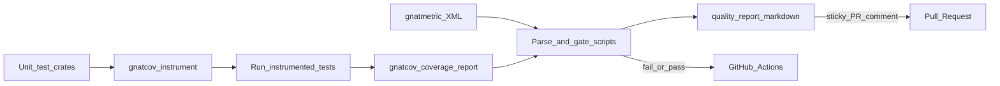

# Code coverage, complexity, and CRAP (roadmap 1.002 macro step 7)

#47 — https://github.com/sanelli/lovelace/issues/47

Branch: `feature/47-coverage-complexity-crap` (from `main` via `gh issue develop`).

Plan file: [`.cursor/plans/047-coverage-complexity-crap.plan.md`](047-coverage-complexity-crap.plan.md)

Roadmap: [docs/roadmap/1.002-roadmap-replace-synthesized-print.md](../../docs/roadmap/1.002-roadmap-replace-synthesized-print.md) § Macro step 7.

**Done:** issue #47, linked branch `feature/47-coverage-complexity-crap`, this plan file.

**How to execute:** one numbered step per invocation (or an explicit consecutive range). Do not skip the envelope (1–3) or the closing tests/PR. After each Ada edit step, run `alr exec -- gnatformat` on touched files and build/run the relevant test crate before moving on.

## Locked decisions

### Tools (host install, not crate `depends-on`)

| Tool | Install | Role |
| --- | --- | --- |
| **gnatcov** | `alr install gnatcov` | Statement / decision / subprogram coverage |
| **gnatmetric** | already via `alr install libadalang_tools` | Cyclomatic / essential / nesting / coupling |

Same pattern as [GNATdoc](../../docs/gnatdoc.md): invoke from scripts; **do not** add either as `[[depends-on]]` on library or CLI crates. Update [`.cursor/rules/dependencies.mdc`](../rules/dependencies.mdc) allowlist to name **gnatcov** (and note **gnatmetric** under libadalang_tools, like gnatformat).

### Coverage (gnatcov)

- Level: **`stmt+decision+fun_call`**
- Units of interest: host library / CLI projects — `lovelace_common`, `lovelace_lir`, `lovelace_compiler`, `lovelace` (exclude nested `*_tests` sources and Alire `config/`)
- Driver: **unit-test** crates only (`common/tests`, `lir/tests`, `compiler/tests`, `lovelace/tests`) — not integration tests (keeps instrumentation focused; integration stays in `run-tests.ps1`)
- Annotate: `xcov` + `report` under a gitignored output dir (e.g. `.coverage/`); HTML if the installed gnatcov build supports it, else skip HTML without failing
- **CI / local gates (fail if below):**

| Metric | Minimum |
| --- | --- |
| Statement (obligation %; use report Stmt section / equivalent) | **95%** |
| Decision | **95%** |
| Subprogram entry (`fun_call` subprogram obligations; not call-site %) | **95%** |

- Call-site half of `fun_call`: **report only**, not a gate.

### Complexity (gnatmetric)

Per eligible subprogram / task / entry / package-body statement sequence in host library + CLI **bodies** (same projects as coverage units of interest; exclude tests):

| Metric | Gate |
| --- | --- |
| Cyclomatic complexity (total) | **≤ 10** |
| Essential complexity | **≤ 10** |
| Max loop nesting | **≤ 4** |

Extra exit points, fan-in / fan-out coupling: **report only** (print summary; no fail).

**No permanent complexity allowlist.** If current code exceeds the gates, **refactor in this issue** until clean (parser / IR / codegen packages included).

### CRAP (computed)

Formula (per subprogram):

```text
CRAP(m) = CC(m)^2 * (1 - cov(m)/100)^3 + CC(m)
```

- `CC(m)` from gnatmetric cyclomatic complexity
- `cov(m)` = statement-coverage percentage for that subprogram from gnatcov (join by fully qualified name / source span; document the join key in `docs/coverage.md`)
- **Gate: CRAP(m) ≤ 30** for every measured subprogram
- Also print **max** and **average** CRAP; do not gate “combined” sum (always grows with new code)

### Local + CI

- Local: PowerShell scripts from repo root (same style as [`scripts/run-tests.ps1`](../../scripts/run-tests.ps1) / [`scripts/gnatdoc.ps1`](../../scripts/gnatdoc.ps1)) — developers can run coverage/metrics anytime
- CI: coverage, complexity, CRAP gates, and the sticky metrics comment run **only on `pull_request`** (targeting `main`). They do **not** run on `push` to `main` (merge / direct push). Ordinary build + unit/integration tests on `main` stay as they are today
- Preferred shape: a dedicated job (e.g. `quality`) with `if: github.event_name == 'pull_request'`, or the same condition on the coverage/metrics steps — install gnatcov, run the scripts, post the sticky comment, **fail the PR check** on any gate breach
- **No** CI artifact upload of `.coverage/` / metrics XML (local dirs remain for developers; gitignored)
- Scripts must be **fail-closed** on parse errors (missing report / unexpected format → non-zero exit), not silent pass

### Sticky PR metrics comment

- One reusable comment per PR, identified by a fixed HTML marker (e.g. `<!-- lovelace-quality-metrics -->`) so each CI run **updates** the same comment instead of stacking new ones
- Body is Markdown produced by `scripts/quality-report.ps1` (also writable to stdout / a file for local use)
- Table columns for **every gated metric** plus reported-only rollups that belong in the summary:

| Metric | Value | Threshold | Status |
| --- | --- | --- | --- |
| Statement coverage | …% | ≥ 95% | ✅ or ⛔️ |
| Decision coverage | …% | ≥ 95% | ✅ or ⛔️ |
| Subprogram coverage | …% | ≥ 95% | ✅ or ⛔️ |
| Max cyclomatic complexity | … | ≤ 10 | ✅ or ⛔️ |
| Max essential complexity | … | ≤ 10 | ✅ or ⛔️ |
| Max loop nesting | … | ≤ 4 | ✅ or ⛔️ |
| Max CRAP | … | ≤ 30 | ✅ or ⛔️ |
| Average CRAP | … | (info) | — |
| Call-site coverage | …% | (info) | — |

- Status column: **✅** when the value meets the gate; **⛔️** when it breaches; info-only rows use `—` (not gated)
- Optionally append a short “worst offenders” list (subprograms failing CC/CRAP) below the table — still part of the same sticky comment
- Workflow: `pull-requests: write` permission on the PR-only quality job; create-or-update via `gh api` / `marocchino/sticky-pull-request-comment` (or equivalent)
- Comment is posted even when gates fail (so the PR shows ⛔️ rows); the job exit code still fails the check
- Because the whole quality job is PR-only, there is nothing to skip on `main` merge beyond the job `if`

### Out of scope

- Integration-test-driven coverage as a gate
- Lovelace `.love` source coverage
- Object-level (`branch`/`insn`) gnatcov modes
- MCDC / `uc_mcdc` as CI gates (decision is enough for branch-analogue)
- Coupling / exit-point fail thresholds
- Codecov.io / other SaaS uploaders
- Uploading `.coverage/` or metrics XML as GitHub Actions artifacts

## Architecture




Typical Alire + gnatcov flow per test crate (adapt to monorepo pins; instrument **library** projects of interest while building the test executable):

1. `alr with` / ensure gnatcov on PATH via `~/.alire/bin`
2. `alr gnatcov instrument --level=stmt+decision+fun_call --dump-trigger=atexit --projects=<lib.gpr>` (from the test crate env)
3. Rebuild with `--src-subdirs=gnatcov-instr --implicit-with=gnatcov_rts_full`
4. Run test binary → `*.srctrace`
5. `alr gnatcov coverage --level=stmt+decision+fun_call --annotate=xcov,report --output-dir=.coverage ... *.srctrace`
6. Consolidate traces across the four unit crates into one assessment over the four library projects

Exact `alr -C` / `--projects` flags are validated in step 5 against the installed gnatcov version; lock the working command lines in `docs/coverage.md`.

## Implementation steps

### 1. Create GitHub issue

`gh issue create` for coverage + complexity + CRAP (roadmap 1.002 macro step 7). Reuse an equivalent open issue if one exists. Clear proxy env. Record `<n>`.

### 2. Linked feature branch

Sync `main`, then:

```powershell
gh issue develop <n> --name feature/<n>-coverage-complexity-crap --checkout --base main
```

Verify with `gh issue develop --list <n>`.

### 3. Save plan file

Rename/move this draft to [`.cursor/plans/<nnn>-coverage-complexity-crap.plan.md`](coverage-complexity-crap.plan.md) (`<nnn>` = zero-padded `<n>`). Put `#<n>` in the body. Commit with the issue prefix when landing work.

### 4. Allowlist, README, gitignore

- [`.cursor/rules/dependencies.mdc`](../rules/dependencies.mdc): add **gnatcov** as an allowed host tool (install via `alr install`; no crate `depends-on`), parallel to GNATdoc; mention **gnatmetric** from `libadalang_tools`
- [README.md](../../README.md) **Development tools**: add `alr install gnatcov`
- [`.gitignore`](../../.gitignore): ignore `.coverage/`, `*.srctrace`, `*.xcov`, gnatmetric XML output dir (e.g. `.metrics/`)

### 5. `scripts/coverage.ps1`

- Preconditions: gnatcov on PATH; workspace buildable
- Instrument + rebuild + run all **unit** test crates; collect traces; produce consolidated report under `.coverage/`
- Parse statement / decision / subprogram percentages; exit **1** if any gate fails (95 / 95 / 95); exit **2** on parse/tool failure
- Print a short summary table to stdout
- Optional switch to skip gates (report-only) for local exploration — **CI must not use it**

### 6. `scripts/metrics.ps1`

- Run `gnatmetric` (via `alr exec -- gnatmetric` or PATH) over host project sources with XML output into `.metrics/`
- Request at least: `--complexity-cyclomatic`, `--complexity-essential`, nesting, extra exits, coupling (or `--complexity-all` + coupling switches as needed)
- Gate: any unit with CC &gt; 10, essential &gt; 10, or nesting &gt; 4 → exit 1
- Always print top offenders and coupling/exit summaries
- Fail-closed on XML parse errors

### 7. CRAP script / shared join

- Prefer a small PowerShell module or `scripts/crap.ps1` that reads `.metrics/` + `.coverage/` (depends on coverage having been run)
- Join subprogram CC with subprogram statement coverage %; compute CRAP; gate ≤ 30
- Print max / average / worst-N list
- Document join algorithm and known limitations (e.g. generics) in docs

### 8. `scripts/quality-report.ps1` + sticky comment

- Read results already produced by coverage / metrics / crap (JSON or structured side files those scripts write under `.coverage/` / `.metrics/`, or re-parse — prefer one shared summary JSON written by the gate scripts)
- Emit Markdown: title + metrics table (Metric | Value | Threshold | Status) using **✅** / **⛔️** for gated rows; info rows with `—`
- Include the HTML marker comment for sticky updates
- Write `.coverage/quality-report.md` (gitignored) and print to stdout
- CI-only path: create or update the sticky PR comment from that Markdown (`gh api` graphql/REST find-by-marker + edit, or `marocchino/sticky-pull-request-comment` with a stable header). Local runs only write the file / stdout — no GitHub API

### 9. Refactor outliers

- Run metrics/coverage/crap; list failures
- Refactor host Ada (extract helpers, reduce nesting, add tests for coverage holes) until **all gates pass**
- `gnatformat` + relevant AUnit after each package touched
- Do not weaken thresholds; do not land a permanent skip list

### 10. Docs + roadmap + CI

- New [`docs/coverage.md`](../../docs/coverage.md): install tools, local commands, metric definitions, gates table, CRAP formula, sticky-comment format, troubleshooting (instrument rebuild, Windows notes if any)
- Link from README (near Development tools / testing)
- Lock roadmap 1.002 § Macro step 7: tool = gnatcov + gnatmetric; gates as above; sticky PR comment; status with `#<n>`
- [`.github/workflows/build.yml`](../../.github/workflows/build.yml):
  - Keep the existing `build` job on both `pull_request` and `push` to `main` (build + unit + integration) — unchanged trigger behavior for that job
  - Add a **`quality` job** with `if: github.event_name == 'pull_request'` (Alire/GNAT setup, install gnatcov + gnatmetric, unit tests as needed for instrumentation, then `coverage.ps1` → `metrics.ps1` → `crap.ps1` → `quality-report.ps1`)
  - Job permissions: `contents: read`, `pull-requests: write` (sticky comment)
  - Post/update sticky comment from the report Markdown (**even if gates failed** — `if: always()` once the report file exists)
  - **Do not** run coverage/metrics/CRAP/comment on `push` to `main`
  - **Any non-zero exit from gate scripts fails the PR check**; do **not** upload coverage/metrics artifacts

### 11. Full test run

- `pwsh scripts/run-tests.ps1`
- `pwsh scripts/coverage.ps1`
- `pwsh scripts/metrics.ps1`
- `pwsh scripts/crap.ps1` (order: coverage before crap)
- `pwsh scripts/quality-report.ps1` (local Markdown only)

### 12. Push + PR

Clear proxy env; `git push -u origin HEAD`; `gh pr create` referencing `#<n>` and roadmap macro step 7. Summarize scripts, gates, sticky comment, and any refactors required to meet CC/CRAP.

## Threshold quick reference

| Gate | Value |
| --- | --- |
| Statement coverage | ≥ 95% |
| Decision coverage | ≥ 95% |
| Subprogram coverage | ≥ 95% |
| Cyclomatic complexity | ≤ 10 |
| Essential complexity | ≤ 10 |
| Max loop nesting | ≤ 4 |
| CRAP | ≤ 30 |

## Error / policy notes

- Threshold numbers live in one place (script constants + `docs/coverage.md`); keep them identical
- Raising gates later is a docs + script + roadmap change; lowering requires an explicit follow-up issue
