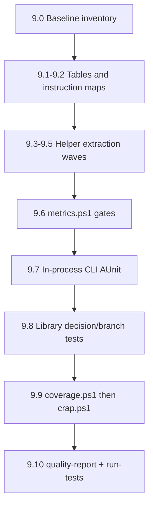

# Step 9 — Refactor outliers (sub-plan for #47)

Parent: [`.cursor/plans/047-coverage-complexity-crap.plan.md`](047-coverage-complexity-crap.plan.md) §9  
Issue: #47 — https://github.com/sanelli/lovelace/issues/47  
Branch: `feature/47-coverage-complexity-crap`

**How to execute:** one numbered sub-step (`9.N`) per invocation (or an explicit consecutive range). Do **not** start step 10 until `9.10` is green. After each Ada edit wave: `alr exec -- gnatformat` on touched files; build/run the **relevant** test crate; re-check affected metrics (`metrics.ps1 -SkipGates` mid-wave is OK).

## Locked decisions (step 9)

- **Scope 1A:** Stay on this branch until **all** parent gates pass. No permanent allowlist, no threshold weakening, no excluding `lovelace.gpr` from metrics/coverage.
- **Split style:**
  - **Tables** when arms are uniform (enum → string/bytes/handler): `constant array (Enum) of …` or opcode maps. Target CC ≈ 1–3.
  - **Helpers** when control flow is irregular (pipelines, parsers, nested validation): extract phase procedures that each stay ≤10 CC / ≤10 essential; orchestrator is straight-line / early-return Result chain.
- **CRAP math reminder:** at 100% coverage, CRAP = CC → every body with **CC > 30** must be split even if fully tested. At 0% coverage, CRAP = CC²+CC → bodies need **CC ≤ 5** or tests.
- **Coverage:** keep instrumenting all four library projects via existing unit-test crates. Prefer **in-process** AUnit over spawning the uninstrumented `lovelace` binary for paths that must credit CLI sources.
- **Nesting:** already ≤4 globally; do not introduce deeper loop nesting when extracting helpers.

## Baseline (9.0 SkipGates run, 2026-11-25)

| Gate | Current | Target |
| --- | ---: | ---: |
| Statement | 82% | ≥ 95% |
| Decision | 46% | ≥ 95% |
| Fun_call | 84% | ≥ 95% |
| Max CC / essential / nesting | 55 / 46 / 3 | ≤ 10 / ≤ 10 / ≤ 4 |
| CC / essential breach counts | 45 / 14 | 0 / 0 |
| Max CRAP / breach count | 2070 / 17 | ≤ 30 / 0 |

After **9.1**: CC breach count **38** (was 45). All 9.1 targets ≤10 CC.

Decision gap is mostly one-sided `!` branches (~42% of decisions); top files: `lovelace-lir-binary.adb`, `lovelace-main-compile.adb`, parser, tokenizer, literals. CLI is gated but largely uncredited by unit tests (compile tests spawn external binary).

Full breach list: `.metrics/units.json` (filter `cyclomatic > 10` or `essential > 10`). Snapshot of worst:

| CC | Ess | Unit | File |
| ---: | ---: | --- | --- |
| 55 | 46 | `Modules.Validate` | `lovelace-lir-modules.adb` |
| 45 | 28 | `Main.Compile.Run` | `lovelace-main-compile.adb` |
| 37 | 25 | `Parser.Parse_Procedure_Declaration` | `lovelace-compiler-parser.adb` |
| 34 | 2 | `Error_Codes.Label` | `lovelace-compiler-error_codes.adb` |
| 33 | * | `Binary.Decode` / `Parse_Subroutine` / `Wasm.Encode_Component` / `Describe_Token` / `Append_Instruction` / `Wat.Instruction_Text` | lir/compiler backends |

## Strategy overview

Complexity reductions first (lower CC drops CRAP even before coverage), then coverage campaigns, then final CRAP mop-up.

---

### 9.0 Baseline

- `pwsh scripts/metrics.ps1 -SkipGates`
- `pwsh scripts/coverage.ps1 -SkipGates` (long)
- `pwsh scripts/crap.ps1 -SkipGates`
- `pwsh scripts/quality-report.ps1`
- Confirm breach counts vs this plan; adjust wave file list if new outliers appear.

---

### 9.1 Uniform tables (quick CC wins)

Convert flat enum/`case` maps to `constant array (…) of …` (or range-sliced tables) so CC ≈ 1.

| Target | File | Approach |
| --- | --- | --- |
| `Error_Codes.Label` | [`lovelace/compiler/src/lovelace-compiler-error_codes.adb`](../../lovelace/compiler/src/lovelace-compiler-error_codes.adb) | `array (Error_Code) of String_Access` / unbounded constant strings |
| `Parser.Describe_Token` | [`lovelace/compiler/src/lovelace-compiler-parser.adb`](../../lovelace/compiler/src/lovelace-compiler-parser.adb) | Kind → string table; or Keyword/Punctuation/Directive sub-tables + thin outer dispatch |
| `Reporting.To_Error_Code` | `lovelace-compiler-reporting.adb` | enum map if 1:1 |
| `Ir_Generator.Map_Value_Type` | `lovelace-compiler-ir_generator.adb` | type → LIR type table |
| `Lir.Text.Type_Token` | `lovelace-lir-text.adb` | type → token string table |
| `Backend.Names.Sanitize_Segment` / `Lowering.Kebab_Export_Name` | backend ads/adb | char-class helpers or small tables if still case-heavy |

**Done when:** each target CC ≤ 10 (expect ≤ 3); existing diagnostics/label tests still pass.

---

### 9.2 Instruction dispatch (Wasm / Wat)

| Target | File | Approach |
| --- | --- | --- |
| `Wasm.Append_Instruction` | [`lovelace/compiler/src/lovelace-compiler-backend-wasm.adb`](../../lovelace/compiler/src/lovelace-compiler-backend-wasm.adb) | Family helpers (consts/locals, i32 arith/cmp, memory/convert, control) **or** opcode→bytes table + rare special cases |
| `Wat.Instruction_Text` | [`lovelace/compiler/src/lovelace-compiler-backend-wat.adb`](../../lovelace/compiler/src/lovelace-compiler-backend-wat.adb) | Mirror Wasm family boundaries for dual maintenance |

Prefer shared conceptual families even if packages stay separate. Keep public API unchanged.

**Done when:** both ≤ 10 CC; backend AUnit still green.

---

### 9.3 High-essential pipelines (helpers)

Extract phase procedures; orchestrator only sequences Results (early return, no deep nested `case Ok`).

| Target | File | Helper sketch |
| --- | --- | --- |
| `Modules.Validate` | [`lovelace/lir/src/lovelace-lir-modules.adb`](../../lovelace/lir/src/lovelace-lir-modules.adb) | Identity, Dependencies, Named_Slots, Subroutine_Flags, Body_Instructions |
| `Main.Compile.Parse_Options` | [`lovelace/lovelace/src/lovelace-main-compile.adb`](../../lovelace/lovelace/src/lovelace-main-compile.adb) | Per-flag `Apply_*` helpers; loop only dispatches |
| `Main.Compile.Run` | same | `Resolve_Paths`, `Run_Frontend`, `Decide_Stale`, `Emit_Wasm_*`, `Emit_Wat_*`, `Emit_Wit` |
| `Lir.Binary.Decode` | [`lovelace/lir/src/lovelace-lir-binary.adb`](../../lovelace/lir/src/lovelace-lir-binary.adb) | Magic/Version, Header, Deps, Preamble, Bodies |
| `Lir.Binary.Parse_Subroutine` | same | Signature/Params, Locals, Instruction_Stream (opcode case alone ≤ 10) |

**Done when:** each ≤ 10 CC and ≤ 10 essential; lir validation/binary tests + compile helper tests pass.

---

### 9.4 Parser and encode/emit phases

| Target | Approach |
| --- | --- |
| `Parse_Procedure_Declaration` | `Parse_Export_Prefix`, `Parse_Native_Binding`, `Parse_Intrinsic_Marker`, header/params, stub vs body finishers |
| Other parser breaches (`Parse_Block`, `Parse_Flavor_Conditional`, `Parse_Integer_Type`, `Parse_Parameter_Group`, `Parse_Compilation_Unit`) | Extract nested alternatives into named parsers |
| `Wasm.Encode_Component` / `Encode_Core_Module` | Section/phase appenders (stdout prelude, aliases, types, canon, exports, customs) |
| `Wat.To_Wat` | Parallel phases to Wasm |
| `Backend.Lowering.Lower` | Per-construct lowerers |
| `Ir_Generator.Generate` | Phase helpers (decls → bodies → …) |

**Done when:** listed units ≤ 10 CC / ≤ 10 essential; parser + backend tests pass.

---

### 9.5 Mid-band and remaining CC 11–20

Work file-by-file from `.metrics/units.json` until breach count is 0. Priority clusters:

- **Literals:** `Interpret_Float` / `Interpret_Integer` → sign / base / digits / suffix helpers ([`lovelace-compiler-literals.adb`](../../lovelace/compiler/src/lovelace-compiler-literals.adb))
- **UTF-8:** `Utf_8.Decode` → `Decode_1`…`Decode_4` + shared continuation checks; add dedicated common AUnit ([`lovelace-common-utf_8.adb`](../../lovelace/common/src/lovelace-common-utf_8.adb))
- **CLI:** `Terminal.Put_Error_Text`, `Arguments.Parse` → helpers
- **Regex:** `Parse_Class`, `Parse_Unicode_Escape`, `Match_Prefix`, `Parse_Atom`, `Parse_Escape`
- **Other:** versioning, diagnostics `Line_Bounds`, `unit_graph.Load_Dependency`, semantics resolve/typecheck, tokenizer leftovers, `Lir.Text.To_Text`

**Done when:** `metrics.ps1 -SkipGates` shows max CC/essential ≤ 10 and breach counts 0.

---

### 9.6 Complexity gates (hard)

- `pwsh scripts/metrics.ps1` **without** `-SkipGates`
- Fix any stragglers immediately
- Do not proceed to coverage waves with failing metrics

---

### 9.7 CLI in-process coverage

Today [`lovelace/lovelace/tests`](../../lovelace/lovelace/tests) mostly spawns the real binary → **no credit** under gnatcov for `lovelace-main-*.adb`.

- Add AUnit that calls `Compile.Parse_Options` / `Compile.Run` / `Main.Run` / `Terminal.*` **in-process** with temp dirs and fixtures
- Cover success + failure branches (bad flags, missing files, stale/skip emit, wat/wit/wasm formats, warning policies)
- Keep or thin spawn-based tests only where process boundaries matter; they do not replace in-process coverage

**Done when:** CLI xcov shows substantial `+` on main-compile/terminal/main; fun_call/stmt for `lovelace.gpr` clearly moved.

---

### 9.8 Library decision / branch coverage

Drive decision from ~46% → ≥95% by forcing **both sides** of `!` decisions. Hot order (from coverage index):

1. `lovelace-lir-binary.adb` — truncated/corrupt streams, each failure arm
2. `lovelace-compiler-parser.adb` — error paths, flavor falses, native/intrinsic edges
3. `lovelace-compiler-tokenizer.adb`
4. `lovelace-compiler-literals.adb`
5. `lovelace-common-regex.adb`
6. versioning, unit_graph, diagnostics, remaining compiler packages

Use existing test crates; add focused cases rather than one mega-suite. After each cluster: `coverage.ps1 -SkipGates` and check decision delta.

**Done when:** decision ≥ 95%, statement ≥ 95%, fun_call ≥ 95% under `-SkipGates` preview (or full `coverage.ps1`).

---

### 9.9 Coverage + CRAP hard gates

- `pwsh scripts/coverage.ps1` (fail on threshold)
- `pwsh scripts/crap.ps1` (fail on threshold)
- For any remaining CRAP > 30: either raise that unit’s coverage or split further (CC must be ≤ 30 even at full cov; lower if cov incomplete)
- Re-run metrics if splits landed in this wave

---

### 9.10 Verify

- `pwsh scripts/quality-report.ps1` — all gated rows ✅
- `pwsh scripts/run-tests.ps1`
- `gnatformat` clean on all touched Ada
- Update parent plan todo `9` → completed; leave step 10+ to parent plan

## Out of scope (parent steps)

- Docs / roadmap lock / CI `quality` job → **step 10**
- Final full-matrix sign-off already listed there → **step 11**
- Push / PR → **step 12**

## Working rules

- No `#` skip lists, no raising thresholds, no dropping projects from [`scripts/coverage.ps1`](../../scripts/coverage.ps1) / [`scripts/metrics.ps1`](../../scripts/metrics.ps1)
- Prefer small commits per sub-step or per package cluster (message prefix `#47`)
- Do not expand public APIs unless needed for testing; prefer `friend` test hooks already used in-tree
- Coupling / extra exits remain report-only (no gate)
