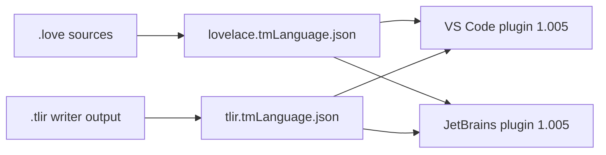

# TextMate grammars for `.love` and `.tlir` (roadmap 1.002 macro step 8)

#49 — [IDE: TextMate grammars for .love and .tlir (roadmap 1.002 macro step 8)](https://github.com/sanelli/lovelace/issues/49)

Branch: `feature/49-textmate-grammars` (from `main` via `gh issue develop`).

Plan file: [`.cursor/plans/049-textmate-grammars.plan.md`](049-textmate-grammars.plan.md)

Roadmap: [docs/roadmap/1.002-roadmap-replace-synthesized-print.md](../../docs/roadmap/1.002-roadmap-replace-synthesized-print.md) § Macro step 8.

**Done:** issue #49, linked branch `feature/49-textmate-grammars`, this plan file.

**How to execute:** one numbered step per invocation (or an explicit consecutive range). Do not skip the envelope (1–3) or the closing tests/PR. After each Ada edit step (none expected here), run `alr exec -- gnatformat` on touched files; for this slice, validate JSON + fixtures instead.

## Locked decisions

### Deliverables (this slice only)

| Artifact | Path |
| --- | --- |
| Lovelace grammar | [`ide/textmate/Lovelace.tmbundle/`](../../ide/textmate/Lovelace.tmbundle/) (`Syntaxes/Lovelace.tmLanguage.json`) |
| TLIR grammar | [`ide/textmate/TLIR.tmbundle/`](../../ide/textmate/TLIR.tmbundle/) (`Syntaxes/TLIR.tmLanguage.json`) |
| Fixtures | [`ide/textmate/fixtures/`](../../ide/textmate/fixtures/) (checked-in `.love` + `.tlir` snippets) |
| Docs | Expand [`ide/textmate/README.md`](../../ide/textmate/README.md); lock roadmap step 8 |

- **Format:** JSON TextMate (`*.tmLanguage.json`). No YAML, no plist, no build step, no Node/npm.
- **Scopes:** `source.lovelace` (`.love`) and `source.lovelace.tlir` (`.tlir`).
- **`fileTypes`:** `["love"]` and `["tlir"]` in the respective grammars.
- **Reuse:** VS Code / JetBrains ([1.005](../../docs/roadmap/1.005-roadmap-ide-plugins-build-run.md)) must load these files — do **not** fork highlighters. This PR does **not** implement those plugins (stubs stay as they are).
- **Binary `.lir`:** out of scope (no highlighter).
- **Language surface:** color **only what the tokenizer/parser already accept** after steps 1–7. Do **not** keyword-color future words (`if`/`then`/`else`/`mod`/`rem`/`and`/`or`/`not`/`while`/…). Later 1.002 steps update these grammars in the same work ([documentation rule](../rules/documentation.mdc)).
- **Validation:** no new CI job and no npm `vscode-textmate` harness. Validate grammars are well-formed JSON; smoke against fixtures + existing [`samples/`](../../samples/) / a `--generate-tlir` artifact. Manual “Inspect Editor Tokens and Scopes” is documented in the README for humans with VS Code.

### `.love` grammar coverage (align with [token-grammar.md](../../docs/token-grammar.md))

| Pattern | Scope (illustrative) |
| --- | --- |
| `{ … }` block comments (non-nesting; strings win) | `comment.block.lovelace` |
| `#if` / `#elsif` / `#else` / `#end` | `keyword.control.directive.lovelace` |
| Keywords: `program` `module` `begin` `end` `declare` `export` `using` `procedure` `integer` `float` `signed` `unsigned` `boolean` `true` `false` | `keyword.control` / `storage.type` / `constant.language` as appropriate |
| `@intrinsic` `@native` `@version` (and other `@ident`) | `storage.modifier.attribute.lovelace` / `entity.name.function.attribute` |
| `"…"` strings (no escapes in Lovelace) | `string.quoted.double.lovelace` |
| Integer / float literals (`0b`/`0o`/`0x`, `f32`/`f64` suffixes) | `constant.numeric.*` |
| Punctuation: `;` `.` `(` `)` `,` `:` `:=` `<` `>` `=` | `keyword.operator` / `punctuation.*` |
| Identifiers (Unicode / emoji; optional `@` already handled) | `variable.other.lovelace` (fallback) |

Scan priority in the grammar repository: **comments → strings → directives → keywords/attributes → numerics → punctuation → identifiers** (mirrors tokenizer intent: strings beat comment braces).

### `.tlir` grammar coverage (align with [lir-text.md](../../docs/lir-text.md))

S-expression highlighter for **canonical writer output** (write-only today; no text parser).

| Pattern | Scope (illustrative) |
| --- | --- |
| Structural heads: `module` `subroutine` `index` `body` `origin` `dependency` `locals` `result` `param` … | `keyword.control.tlir` |
| Instructions: `noop` `i32.const` `call` `local.get` `local.set` | `support.function.instruction.tlir` |
| Types: `unit` `i8`…`i64` `u8`…`u64` `f32` `f64` | `storage.type.tlir` |
| Flag / slot tags: `export` `entrypoint` `native` `intrinsic` `param` | `storage.modifier.tlir` |
| Decimals | `constant.numeric.integer.tlir` |
| Quoted strings + escapes (`\\` `\"` `\n` `\r` `\t` `\u{…}`) | `string.quoted.double.tlir`, `constant.character.escape.tlir` |
| `(`/`)` | `punctuation.section.parens.tlir` |

Closed keyword/opcode lists from the writer — do not invent alternate spellings.

### Fixtures

Under `ide/textmate/fixtures/`:

- `love/` — small hand-written snippets covering comments, directives, `@intrinsic`/`@native`/`@version`, literals, `declare`/`:=`/`using`, emoji id (prefer **thin dedicated fixtures** so the folder is self-contained).
- `tlir/` — one non-empty module fixture matching writer shape (include `index`, `flags`, `locals`, `body` with all five opcodes) plus the empty-module golden from docs/tests.

### Out of scope

- VS Code / JetBrains extension manifests, `language-configuration.json`, themes, icon themes
- LSP, build/run/debug UI ([1.005](../../docs/roadmap/1.005-roadmap-ide-plugins-build-run.md) / [4.004](../../docs/roadmap/4.004-roadmap-ide-debugger.md))
- Coloring future 1.002 operators / control-flow keywords early
- Highlighting binary `.lir`
- Adding Node/npm or a TextMate CI job
- Changing the Ada tokenizer/parser/LIR writer

## Architecture

## Steps

### 1–3. Envelope

Create issue, branch from latest `main` (preserve any in-progress working-tree roadmap edits — no stash/reset), save this plan with `#49` in the body.

### 4. Lovelace `.love` grammar

Add `ide/textmate/lovelace.tmLanguage.json`:

- `name`: Lovelace; `scopeName`: `source.lovelace`; `fileTypes`: `["love"]`
- Repository patterns for comments, strings, directives, keywords, `@` attributes, numerics, punctuation (`:=` before `:`), identifiers
- Keyword lists exact match to [token-grammar.md](../../docs/token-grammar.md) (case-sensitive)

### 5. TLIR `.tlir` grammar

Add `ide/textmate/tlir.tmLanguage.json`:

- `name`: Lovelace LIR (text); `scopeName`: `source.lovelace.tlir`; `fileTypes`: `["tlir"]`
- S-expr patterns; closed structural / instruction / type / flag lists from [lir-text.md](../../docs/lir-text.md)
- String rule with writer escapes

### 6. Fixtures

Add `ide/textmate/fixtures/love/*.love` and `ide/textmate/fixtures/tlir/*.tlir` as above. Optionally regenerate the TLIR fixture via `lovelace compile … --generate-tlir` from a tiny unit and copy into fixtures (trim absolute `origin` paths if noisy, or use a fixture that omits origins).

### 7. README + roadmap lock

- Expand [`ide/textmate/README.md`](../../ide/textmate/README.md): file list, scope names, keep-in-sync checklist (what to update when adding a keyword / TLIR opcode), how to smoke-test in VS Code, pointer to fixtures
- Remove obsolete `.gitkeep` if grammars replace it
- Lock [roadmap 1.002](../../docs/roadmap/1.002-roadmap-replace-synthesized-print.md) § Macro step 8 status with `#49`
- Touch [`ide/README.md`](../../ide/README.md) only if the table still says “planned” for textmate in a way that should flip to “shipped grammars”

### 8. Validate

- Parse both JSON files (e.g. PowerShell `ConvertFrom-Json` or `python -m json.tool`)
- Spot-check fixtures against patterns (comment/string/`:=`/`@intrinsic` on `.love`; `(module` / `i32.const` / escapes on `.tlir`)
- `pwsh scripts/run-tests.ps1` still green (no Ada regressions expected)

### 9. Push / PR

Clear proxy env; `git push -u origin HEAD`; `gh pr create` closing `#49`, referencing roadmap 1.002 macro step 8.

## Non-goals (reminders)

- Do not implement VS Code or JetBrains plugins in this PR
- Do not color `if` / `mod` / `and` / loop keywords before those language steps land
- Do not add npm or CI TextMate token snapshots
- Do not change compiler or LIR writer behavior
