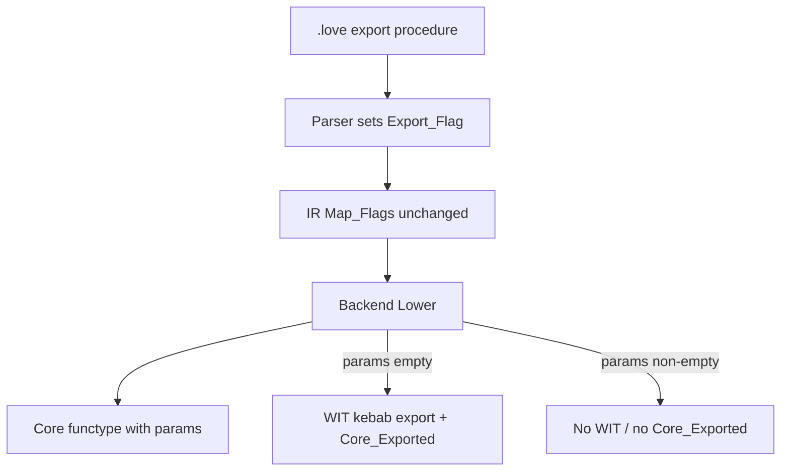

# Export on module procedures (roadmap macro step 2)

#23 — [Compiler: export on module procedures (roadmap macro step 2)](https://github.com/sanelli/lovelace/issues/23)

Branch: `feature/23-export-module-procedures` (linked to #23; created from `main` via `gh issue develop`).

Plan file: [`.cursor/plans/23-export-module-procedures.plan.md`](23-export-module-procedures.plan.md).

Roadmap: [docs/roadmap/001-roadmap-print-integer-wasi.md](../../docs/roadmap/001-roadmap-print-integer-wasi.md) § Macro step 2.

Prerequisite: macro step 1 done ([#21](https://github.com/sanelli/lovelace/issues/21)).

**How to execute:** one numbered step per invocation (or an explicit consecutive range). Do not skip the envelope (1–3) or the closing tests/PR (9–10). After each Ada edit step, run `alr exec -- gnatformat` on touched files and build/run the relevant test crate before moving on.

## Locked decisions

- **Syntax:** optional `export` immediately before `procedure` on module procedures only:
  - `export procedure Print(Value : integer); begin end;`
  - Grammar: `procedure_header = [ "export" ] , "procedure" , identifier , "(" , [ parameter_list ] , ")" , ";" ;`
- **Keyword:** add `export` to `Keyword_Subtype` / tokenizer table / [docs/token-grammar.md](../../docs/token-grammar.md). No `entrypoint` keyword (programs keep implicit `Export_Flag or Entrypoint_Flag`).
- **AST/LIR:** reuse existing `Export_Flag` / `Has_Export`. Parser sets `Flags => Export_Flag` when `export` is present, else `0`. No new flag bit in this slice.
- **Meaning of `Export_Flag` (policy split):**
  - **Lovelace visibility** for future `import` / `MODULE.SUBROUTINE` (roadmap steps 3–5).
  - **WIT/component export** only when the subroutine has **zero parameters** (today’s nullary `func()` path).
  - Parameterized `export procedure` lowers to a **core** function with widened params and **does not** set `Core_Exported` or call `Append_Export`.
- **Entrypoint + parameters:** still rejected (`Unsupported_Type`) — WASI `run` stays nullary.
- **Programs:** unchanged; no procedure syntax, no source `export`.
- **Doc-comments on exports:** deferred until that language feature exists.
- **Out of scope:** `import`, multi-unit resolve, Augusta, WASI imports, statements/calls, parameterized WIT/`canon lift`, `import … as …`, per-flavor output dirs.



## Current code hooks

- Flags already exist: [compiler/src/lovelace-compiler-ast.ads](../../compiler/src/lovelace-compiler-ast.ads), [lir/src/lovelace-lir-subroutines.ads](../../lir/src/lovelace-lir-subroutines.ads); IR copies them in `Map_Flags` ([compiler/src/lovelace-compiler-ir_generator.adb](../../compiler/src/lovelace-compiler-ir_generator.adb)).
- Module procedures always get `Flags => 0` today ([compiler/src/lovelace-compiler-parser.adb](../../compiler/src/lovelace-compiler-parser.adb) ~1424).
- Backend rejects any `Has_Export`/`Has_Entrypoint` with parameters ([compiler/src/lovelace-compiler-backend-lowering.adb](../../compiler/src/lovelace-compiler-backend-lowering.adb) ~110–118) and sets `Core_Exported := Has_Export` (~99) before `Append_Export` (~153–160).
- Docs/tests still say module procedures are never exported ([docs/parser.md](../../docs/parser.md), [docs/codegen.md](../../docs/codegen.md), `Test_Module_Procedure` in parser tests).

## Surface grammar (this slice)

```ebnf
procedure_declaration = procedure_header , "begin" , "end" , ";" ;
procedure_header      = [ "export" ] , "procedure" , identifier ,
                        "(" , [ parameter_list ] , ")" , ";" ;
```

`export` is only meaningful where procedures already parse (module declaration lists, including inside `#if` arms via existing `Keep_Declarations`). A lone `export` without `procedure` is `Unexpected_Token`.

## Implementation steps

### 1. GitHub issue

Create (or reuse) an issue with `gh issue create` for roadmap macro step 2. Record `<n>`. Clear proxy env before `gh` (agent-workflow).

**Done:** [#23](https://github.com/sanelli/lovelace/issues/23).

### 2. Linked branch from `main`

```powershell
git fetch origin; git checkout main; git pull origin main
gh issue develop 23 --name feature/23-export-module-procedures --checkout --base main
gh issue develop --list 23
```

**Done:** branch linked and checked out.

### 3. Save plan file

Write [`.cursor/plans/23-export-module-procedures.plan.md`](23-export-module-procedures.plan.md) with `#23` in the body.

**Done:** this file.

### 4. Tokenizer: `export` keyword

- Add `Export_Keyword` to `Keyword_Subtype` in [compiler/src/lovelace-compiler-tokens.ads](../../compiler/src/lovelace-compiler-tokens.ads).
- Register lexeme `"export"` in the keyword table in [compiler/src/lovelace-compiler-tokenizer.adb](../../compiler/src/lovelace-compiler-tokenizer.adb).
- AUnit: tokenize `export procedure` / lone `export` as keyword.
- Update [docs/token-grammar.md](../../docs/token-grammar.md) and [docs/tokenizer.md](../../docs/tokenizer.md).

### 5. Parser: optional `export` → `Export_Flag`

- In `Parse_Procedure_Declaration` / header parse: if next token is `export`, consume it and set `Flags => Ast.Export_Flag`; else `0`. Then expect `procedure` as today.
- Keep programs’ synthetic entrypoint+export path unchanged.
- AUnit parser tests:
  - `export procedure` (nullary and with params) → `Has_Export`, not `Has_Entrypoint`
  - plain `procedure` → still no export (update `Test_Module_Procedure` only if still accurate)
  - `export` inside active `#if` arm survives; inactive arm discarded
  - negative: `export` not followed by `procedure`
- Update [docs/parser.md](../../docs/parser.md) and [docs/compilation-unit-grammar.md](../../docs/compilation-unit-grammar.md).

### 6. IR generator tests (no production change expected)

- Confirm `Map_Flags` already maps `Export_Flag`.
- Add IR-generator AUnit: parse `export procedure P(X : integer); begin end;` → LIR `Has_Export`, parameters present, not entrypoint.
- Update [docs/ir-generator.md](../../docs/ir-generator.md) only if the flag table wording still says modules never export.

### 7. Backend: Lovelace visibility vs WIT export

In [compiler/src/lovelace-compiler-backend-lowering.adb](../../compiler/src/lovelace-compiler-backend-lowering.adb):

1. Reject **only** `Has_Entrypoint` with non-empty parameters (keep failure message clear).
2. Allow `Has_Export` with parameters.
3. Set `Core_Exported` and call `Append_Export` **only** when `Has_Export` and parameter count is 0.
4. Parameterized exported procedures: core functype + body only (same path as today’s non-exported typed params).

Update backend AUnit in [compiler/tests/src/lovelace-compiler-tests-backend.adb](../../compiler/tests/src/lovelace-compiler-tests-backend.adb):

- Replace “export with parameters → `Unsupported_Type`” with success: core params present, WIT has **no** kebab export for that name.
- Keep nullary export-only / entrypoint / two-exports tests green.
- Keep entrypoint+parameters as failure if covered.

Update [docs/codegen.md](../../docs/codegen.md): table rows for export+params and the “module procedures are not exported yet” note; document the visibility vs WIT rule.

### 8. Sample + docs + roadmap note

- Add [`samples/module/ExportProcedures.love`](../../samples/module/ExportProcedures.love) (basename = module name): at least one `export procedure` with an integer parameter and one non-exported procedure.
- Update [docs/samples.md](../../docs/samples.md).
- Wire into module integration build if [lovelace/integration_tests](../../lovelace/integration_tests) lists module samples explicitly.
- Mark roadmap macro step 2 status (issue link) in [docs/roadmap/001-roadmap-print-integer-wasi.md](../../docs/roadmap/001-roadmap-print-integer-wasi.md), same style as step 1 / #21.
- Brief note in [docs/directives.md](../../docs/directives.md) only if needed (export is not a directive).

### 9. Run all tests

Run existing nested AUnit crates / `scripts/run-tests.ps1` (and integration tests if that script includes them). Fix regressions before PR.

### 10. Push and PR

Clear proxy env, `git push -u origin HEAD`, `gh pr create` summarizing export syntax + Lovelace-vs-WIT lowering policy. PR body references `#23` and roadmap macro step 2.

## Explicit non-goals (do not pull in)

- Resolving `import` or searching `augusta/`
- Emitting `export print: func(s32)` / Canonical ABI for parameters
- Changing program entrypoint synthesis
- Adding a second LIR flag bit (`Component_Export` / etc.) — revisit only if a later milestone needs nullary Lovelace-visible but non-WIT exports
